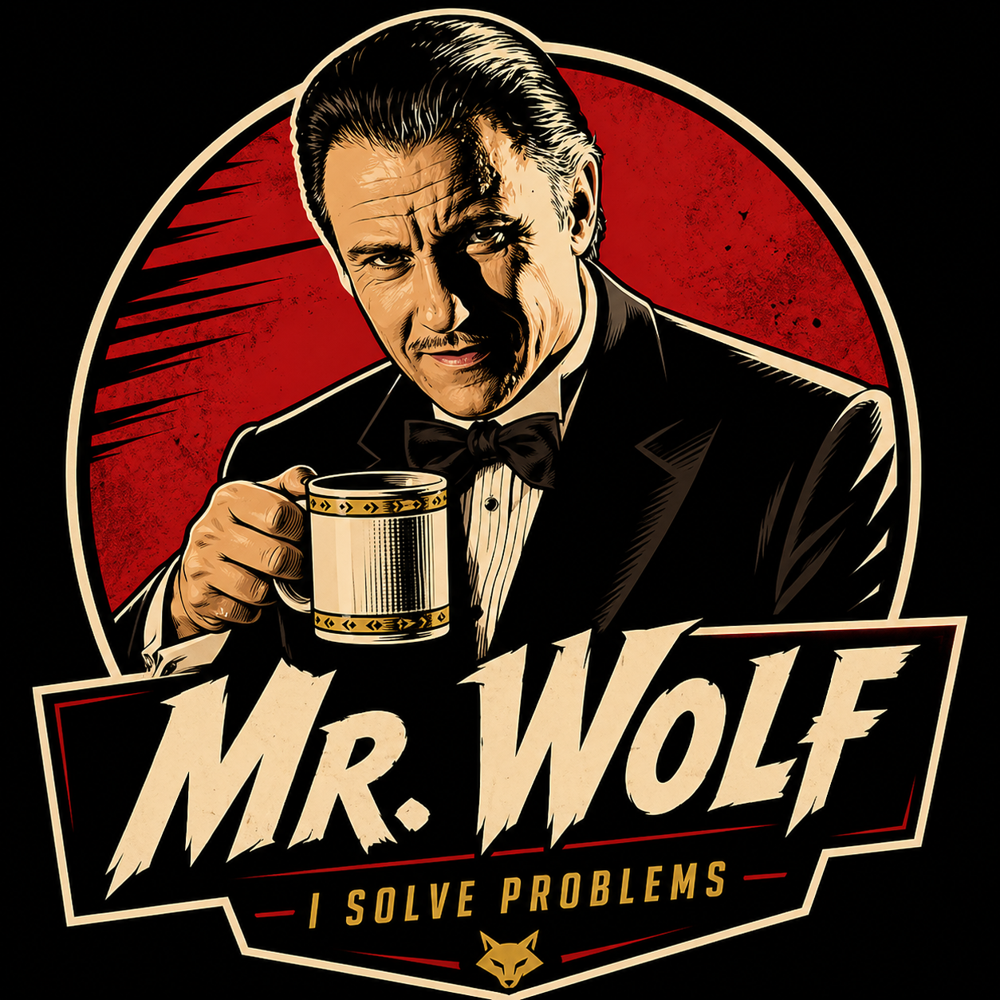

**English** | [Русский](README.ru.md)

# Mr. Wolf



> **I solve problems.**
>
> A permanent project organization built from temporary AI assistants.

Mr. Wolf organizes AI work around your goal. It connects agents, skills, tools, rules and project memory into a process: understand the need, organize delivery, check the result and retain what matters for the next session. Complaints and lessons are recorded with their reasons and history, so feedback can become controlled changes to how the organization works.

Wolf is also your point of contact with that organization: explain what you need in ordinary language, discuss meaningful choices, and receive a result you can understand and assess.

**[Read the documentation](https://chekh.github.io/mister-wolf/guide/overview)** · [Getting started](https://chekh.github.io/mister-wolf/guide/getting-started) · [What is available today](https://chekh.github.io/mister-wolf/guide/capabilities)

## Why Wolf

- **Keep the goal in view.** mr-wolf, the lead agent, owns the goal and final acceptance: it executes work itself and hires the eight `wolf-` specialists directly — `wolf-architect`, `wolf-developer`, `wolf-editor`, `wolf-expert`, `wolf-release-engineer`, `wolf-researcher`, `wolf-reviewer`, `wolf-tester`. Executors do not delegate further: no intermediate level sits between the lead and the agent doing the work, and the lead stays accountable for the outcome over a long assignment.
- **Connect the methods.** A process determines which skills, rules, context and tools apply, what to delegate, when to ask and how to verify. Assigned skills supply each executor's specialization; a new independent piece of work gets a fresh executor, reuse is bounded to defined continuation cases, and the lead's own work passes the same independent review.
- **Continue across sessions.** Project documents are part of memory, alongside decisions, working state and lessons. Original documents stay canonical in their own files; Wolf records references and relevant context for later work.
- **Learn from feedback.** Complaints and proposals are accepted and recorded with reasons and history; mature lessons can be aggregated. The Steward, which turned such feedback into automatic versioned method changes, is temporarily out of the standard routing and returns in the next release; its mechanisms and history are preserved. This is organizational learning, not model-weight training.
- **Work comfortably with people.** Intent dialogue, clear explanations and timely questions are part of the working method. Internal executor reports are integrated into a useful human-facing answer.
- **Accumulate capabilities you own.** Useful scripts and methods can become reusable project resources. Local files, CLI and MCP keep project state under your control; model calls still use your configured provider.

The [product guide](https://chekh.github.io/mister-wolf/guide/overview) explains how these pieces work together. [Comparison by approach](https://chekh.github.io/mister-wolf/guide/capabilities#how-wolf-relates-to-other-solutions) shows the relationship to agent memory, skill collections, harnesses and multi-agent frameworks, without an invented performance ranking.

## Start with your project

Current full organization: **OpenCode-first**. Requirements: Node.js 22 or 24; macOS or Linux with glibc.

```bash
npm install -g mister-wolf
cd my-project
wolf init --full --platform opencode
wolf bootstrap
```

The package name is **`mister-wolf`**; `mr-wolf` is a different package. `wolf init` requires the project marker in the directory: an empty directory without it is refused instead of being initialized silently. The standard process needs no mandatory plugins — the agent definitions, a short `AGENTS.md` starter block, skill loading and addressed handoff are enough. Restart OpenCode after initialization so its project MCP configuration and default agent load.

Then give Wolf an outcome, for example:

> Help me prepare an onboarding guide for this project. Use the existing documents, identify what a newcomer needs, and produce a concise guide with verified setup steps. Ask me if a missing decision changes the result.

Wolf's supplied methods direct it to clarify the goal, organize bounded work, check the result and preserve significant state. The response should explain what was produced, what was checked and what remains unresolved. The exact run depends on your project, model and harness; this is an example request, not a recorded trace.

[Follow the first session](https://chekh.github.io/mister-wolf/guide/getting-started) for bootstrap expectations, recovery and the optional memory-only setup. You do not need to learn the memory taxonomy to start using the organization.

## Everyday use and updates

Discuss a task or correction with Wolf in your agent environment. [Working with Wolf](https://chekh.github.io/mister-wolf/guide/working-with-wolf) covers clarification, progress, continuation and feedback. [Feedback](https://chekh.github.io/mister-wolf/guide/feedback) explains how complaints and lessons are recorded and how you retain control. The CLI also ships three commands: `analyze-doc` and `doc-review` for document analysis and review, `complain` to file a complaint about an agent, a skill or a memory note.

```bash
wolf upgrade --check   # inspect CLI and registered-project freshness
wolf upgrade          # update the package and registered projects
```

Review local modifications before choosing an update resolution. [Upgrade workflow](https://chekh.github.io/mister-wolf/guide/upgrade) explains diffs, protection and backups.

Updating an installed project to 3.0.0 with `wolf upgrade` delivers the current set and reserves your local edits and the removed Wolf plugins under `.wolf/backup/upgrade/<date>/`. The shipped agents carry persistent `wolf-` names; a repeated upgrade reports the project up to date and does not bring the old hierarchy back. Migrating from a pilot installation follows a separate instruction — see the 3.0.0 upgrade notes in the [changelog](CHANGELOG.md).

## Scope and development

Wolf's organizational methods are applicable beyond coding; the shipped set includes research, document work and reports. The current delivery is repository-based and OpenCode-first. MCP access or another platform's configuration does not imply the complete organization is validated there. The expert council is shipped as a method, not an automatic runtime: a `wolf-expert` role with a read-only channel inside the project boundary (code included; writes, shell, subagents, web fetch and external directories denied), the `wolf-council` method for the lead agent, and a durable record path (`wolf council record`); see the [expert council guide](https://chekh.github.io/mister-wolf/guide/council). A user console and durable execution are not current guarantees. See [capabilities and boundaries](https://chekh.github.io/mister-wolf/guide/capabilities). [Read isolation](https://chekh.github.io/mister-wolf/guide/read-isolation) applies to context delivery through `wolf call`; it is not general read access control.

The **website is the canonical user documentation**; its source is `docs/site/`. [Engineering documents](docs/README.md) retain the concept, requirements, designs and roadmap in Git. [Contributing](CONTRIBUTING.md) describes development and documentation checks. No measured speed, cost or quality effect is claimed: faster answers are the owner's observation, not a measurement, and there are no skill-usage counters — cost can be assessed only from raw usage records.

MIT · [License](LICENSE) · [Release history](https://chekh.github.io/mister-wolf/changelog/)
