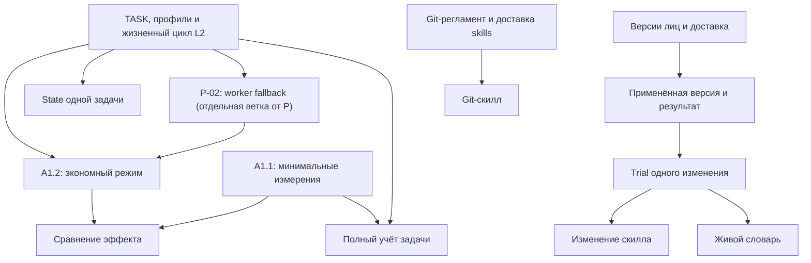

# Roadmap v4 — активный роадмап

> **Редакция 4:** 30 октября 2026 года, после критического ревью. Разделены независимые ранние поставки, уточнены применимость критериев, делегирование, безопасная передача, измерения, State, trial и выпуск. Приоритет — небольшие проверяемые изменения с немедленной практической пользой.
>
> **Статус:** active. Эта редакция принята владельцем как единая активная очередь; она меняет очередь поставок прежнего черновика; полученные ответы владельца и действующие полномочия сохраняются. Редакция документа не означает, что перечисленные механизмы уже реализованы, выпущены или активированы.
>
> **Проверенная база предыдущего аудита:** публичный main и тег v2.21.1, commit 493bedc907002c50f0a8d51662a28c5476797d0e; main/tag повторно сверялись при редакции 2. Редакция 4 адресно сверена с сохранённой базой, requirements и Git-регламентом; она не объявляет эту ревизию текущим HEAD и не подтверждает выпуск будущих версий. Живая частная память проекта не читалась; ссылки на её решения сохранены из присланного документа.
>
> **Ближайший результат:** P-01/P-04 (2.22.0) — компактные поручения и выбор сеанса L2 на проверенном пути доставки. **Выпущен 2026-10-31** (тег `v2.22.0`, npm `mister-wolf@2.22.0`) — остатка в очереди не держит. Предыдущий выпуск очереди, FIX-CACHE (2.21.2), выпущен 2026-10-30. Исправление fallback P-02 выпускается отдельно, если не требуется этому пути. Следом по готовности — B0, независимые FIX и A1.1 с измерениями; A1.2 с экономным поведением не объединяется с ними в обязательный большой релиз. Подробный быстрый старт — §16.

---

## 1. Назначение и основание редакции

Документ определяет очередь поставок, самостоятельный результат каждой, зависимости, критерии перехода и место всех требований. Детальные requirements/design/plan/test-plan ведутся в пакетах соответствующих волн; этот roadmap не заменяет их и не является вторым планировщиком задач.

Для исполнения достаточно прочитать правила/очередь (§2–3), свой срез, его применимые AC (§14) и поручение (§16). L2 получает адресный TASK с нужными нормативными фрагментами; весь roadmap не добавляется в каждый дочерний контекст.

Исходный draft предлагал последовательность 2.22.0 «Канон» → 2.23.0 «Экономия» → 2.24.0 «Автономность Стюарда», затем B/C/D. Текущее поручение владельца задаёт приоритет ранней практической пользы. Поэтому новая редакция:

1. Добавляет быстрый выпуск **P-01/P-04: TASK/RESULT и жизненный цикл L2**; исправление существующего runtime fallback P-02 имеет собственную приёмку и условную зависимость по пути доставки.
2. Выносит **B0 — Git-скилл** в ближайшую самостоятельную поставку на основе git-collaboration-policy.md; переносимые операции B1, очередь MR и выпуск не становятся её общим гейтом.
3. Отделяет независимые маленькие исправления от гейта готовности шаблонов и Git-скилла.
4. Разделяет A1 на **A1.1 — минимальные измерения** и **A1.2 — экономное выполнение**; готовый сборщик начинает приносить данные до выпуска нового режима.
5. Ставит доставку и миграции адресными поставками, без универсальной зависимости всех этапов от полной перезаписи канона.
6. Поднимает **E1 — рабочее состояние одной задачи** в ближайшую очередь, отдельно от полного учёта расходов E2.
7. Сохраняет самостоятельную настройку автономности существующих операций Стюарда.
8. Позволяет начать D1 на конкретном лице без ожидания полного State, Git, council или async jobs.
9. Сохраняет B–I, все Q-ответы, разделение REQ-05A/B и REQ-23A/B и ограничения платных экспериментов.

Это явное перескопление очереди, а не новая интерпретация исторического решения …2b0288. История прежней последовательности и её основания остаются в §17. Новый идентификатор решения памяти этим документом не выдумывается.

### Что считать уже поставленным

В 2.21.1 уже доставлены инструкции о конечных L2-мандатах, подготовленных входах, раннем возврате, изолированной параллельной работе, рабочей адресной памяти и ограниченной автономной агрегации Стюарда. TASK / RESULT / EVIDENCE / ACCEPTANCE уже описаны в using-skills. Повторная перепись этих правил не считается самостоятельной новой возможностью. [S1], [S2]

**Фактчеки обзора относятся к 2.21.0.** Их выводы о наличии механизмов должны проверяться по текущей ревизии перед реализацией. Ни наличие схемы, ни принятое решение, ни текст инструкции по отдельности не доказывают поставку работающего сценария.

**Поверх 2.21.1 выпущен 2.21.2** (2026-10-30) — FIX-CACHE: изоляция схем памяти между проектами. Это patch линии 2.21.x без нового инструкционного контракта; §5 фиксирует его закрытие. Действующая база настоящей редакции — 2.21.2 (`5ec4e4f`).

---

## 2. Правила поставки

1. **Каждый релиз полезен самостоятельно.** Конечный результат, его доставка и проверка определяют границу релиза. Независимая незавершённая работа не удерживает готовый результат.
2. **Номера — полные X.Y.Z и назначаются относительно последнего тега при подготовке выпуска.** Идентичность работы задают P/B0/A1/E1 и их задачи; будущие номера не резервируются в параллельных ветках. Ранний minor B0 сдвигает следующие номера, а FIX выходит patch актуальной линии. Версия, changelog и release notes назначаются владельцем выпуска после выбора готового scope. Параллельные ветки долгосрочной поддержки не вводятся.
3. **Статусы решения и реализации раздельны.** «Ответ владельца получен», «запланировано», «реализовано», «проверено», «поставлено» — разные утверждения.
4. **Каждый REQ получает место.** Частично поставленное требование сохраняет явный остаток. Неявного переноса и объявления всего этапа закрытым по одному срезу нет.
5. **Доставка сопровождает каждую возможность.** Нужные шаблоны, generated/installed-файлы, migration/rollback, release notes и документация входят в её выпуск. A2 ниже содержит самостоятельные старые миграции; необходимая доставка P/B0/A1/E1 до него не откладывается.
6. **Текущий корректный файл можно сохранить.** SHA фиксирует конкретные bytes. Требование «хеш каждого из 61 файла обязательно изменился» снято как критерий полезности; полный поимённый охват payload сохраняется в матрице disposition (§7).
7. **Небольшой контракт — сейчас; runtime-контроль — отдельной реализацией.** TASK не превращает scope в файловый sandbox, бюджет в таймер, а model/variant — в фактически применённую настройку.
8. **Ответственность и модель независимы.** Роль, профиль задачи, FULL/LITE/FIX, execute/solve, standard/draft, model и variant не объединяются в одну шкалу. Уровень L2 сам по себе не означает дешёвую модель.
9. **Готовые входы и конечные поручения.** L1 владеет планом, интеграцией и приёмкой. Сначала он решает, полезно ли делегирование; малую связанную работу может выполнить сам. При делегировании новой самостоятельной задачи используется свежий L2; продолжение и замена различаются по §4. Это не обязанность создавать агента для каждого пункта плана. Независимость требуемой приёмки сохраняется. L2 возвращает RESULT/evidence сообщением; временные отчёты не засоряют docs/dev.
10. **Рабочая память адресная.** note/context, note/history, note/metric и существующие governance-поля применяются по назначению. Промежуточная заметка автоматически не становится lesson, complaint или новой процедурой.
11. **Согласованную автономность сохранять.** Q-ответы и уже разрешённые действия не отправляются на повторное общее согласование. Перед исполнением проверяются актуальные ограничения и версия основания; существенный новый конфликт решается по действующей policy.
12. **Экономию измерять по результату.** Обязательные проверки, независимая приёмка, права и человеческая понятность сохраняются. Короткий служебный текст сам по себе не доказывает уменьшение расходов.
13. **Платная кампания отдельно.** Q-04 сохраняется: разрешены подготовка harness/сценариев и наблюдение уже разрешённой работы; дополнительные платные задания или автоматические A/B этим roadmap не запускаются.

### Как перейти от roadmap к выпуску

У каждого выбранного среза в существующем плане/ACCEPTANCE фиксируются владелец интеграции, baseline SHA, конечный результат, включённые задачи и явный остаток, применимые AC из §14, поддержанный путь установки/доставки и способ возврата. Это запись в уже используемых артефактах, не новый обязательный пакет документов или TaskState-store. Архивный номер большой волны не становится гейтом маленького среза.

Проверка поставки различает: **bytes изменены → установленная версия доступна → нужная версия фактически загружена → заявленное поведение проверено**. Успех предыдущего шага не доказывает следующий. Проверяются новая и существующая установка на затронутом пути, сохранение model/variant и local/protected-файлов; skip/несовместимость остаются видимыми. Изменение живого лица проводится через уже разрешённый путь Стюарда. Непроверенные поведение и эффект не объявляются доказанными; кандидат D1/D2 не активируется одним structural lint. Способ проверки и ограниченный исход заранее отражаются в применимых AC, без неразрешённой платной кампании.

---

## 3. Карта поставок и приоритет

**Порядок в таблице отражает приоритет. Технические зависимости перечислены отдельно в §13.** Параллельная совместимость не является общей предпосылкой State, а Git/council не блокируют испытание одного лица.

**Состояние первого выпуска:** FIX-CACHE **выпущен как 2.21.2** 2026-10-30 (patch линии 2.21.x): ветка fix/2.21.1-multi-project-schema-isolation интегрирована и прошла релизный цикл. Основание порядка, действовавшее до выпуска: подтверждённый дефект целостности в опубликованной 2.21.1 — ветка с фиксом не слита, код на релизном SHA содержал глобальный typeSchemaCache без baseDir (§5, [S4]); сначала закрывался дефект целостности, затем выходит новая функциональность P (2.22.0, minor). Теперь очередь начинается с P.

В P-03a входит короткая синхронизация действующего requirements с очередью и матрицей применимости §14. Меняются указатель активного scope и ссылки на пакет выпуска; исходный смысл REQ/AC и историческое evidence сохраняются. Это не новая перепись всей большой волны и не повод снова согласовывать ответы владельца. P-03b — интеграция и доставка среза P.

| Поставка                                         | Место в очереди                                          | Самостоятельный результат                                                                                                           | Старт / зависимость                                                                                                                 |
| ------------------------------------------------ | -------------------------------------------------------- | ----------------------------------------------------------------------------------------------------------------------------------- | ----------------------------------------------------------------------------------------------------------------------------------- |
| **FIX-CACHE — изоляция схем между проектами**    | **Выпущен: 2.21.2** (2026-10-30, patch линии 2.21.x)     | Кэш схем учитывает проектную идентичность; загрузка одного проекта не подменяет схемы другого (§5)                                  | Закрыт: ветка fix/2.21.1-multi-project-schema-isolation интегрирована, релизный цикл 2.21.2 выполнен                                |
| **P — первый инструкционный срез**               | **Выпущен: 2.22.0** (2026-10-31, minor)                  | P-01 TASK core + профили/термины и P-04 fresh/continue/replace; P-03a синхронизирует указатель, P-03b интегрирует и доставляет срез | Закрыт: срез P-01/P-04 выпущен 2026-10-31 (тег `v2.22.0`, npm `mister-wolf@2.22.0`); профиль `research` исполнен на реальной задаче |
| **P-02 — worker fallback**                       | Отдельный ближайший fix либо вместе с P при готовности   | Role-aware отказ/доставка в существующем router, проверенные hooks и три worker-роли                                                | Отдельное изменение runtime, не текстовая имитация; проблемный путь не объявляется исправным до его приёмки                         |
| **B0 — Git-скилл**                               | Ближайший малый выпуск после P; номер по §2              | Вызываемый wolf-git, поставляемый регламент, согласованные worktree/handoff/finish и G0–G2/G9                                       | Готовится параллельно FIX/A1; существующие skills и TASK достаточны; не ждёт B1, E1, G или H                                        |
| **FIX — независимые короткие исправления**       | По готовности каждого пункта; FIX-CACHE выпущен (2.21.2) | FIX-AGG и FIX-SCAFFOLD — отдельные задачи и коммиты                                                                                 | Сложный пункт не удерживает остальные; фикс выходит на актуальную линию                                                             |
| **A1.1 — минимальные измерения**                 | Рано, параллельно B0/FIX                                 | Один importer/writer, устойчивые IDs, честные run-итоги и чтение старых логов                                                       | Один подтверждённый источник; не ждёт нового режима или полного E2                                                                  |
| **A1.2 — экономное поведение**                   | После готовности собственного поведения                  | standard/draft, соразмерное выполнение, жалоба и stop на выбранном пути                                                             | Контракт P; A1.1 до начала измеряемого сравнения, но не обязательный гейт функциональной поставки без заявления об эффекте          |
| **A2 — конкретная совместимость канона**         | Адресные независимые части                               | Сохранение model/variant при обновлении инструкций; command → commands; legacy/analyze-doc/examples; disposition payload            | Разработка параллельна A1; обязательна только для затронутого пути установки/доставки                                               |
| **E1 — рабочее состояние одной задачи**          | Ближайший самостоятельный срез State после P             | Срез-1: восстановление после handoff/replace; план/неизвестные/решения/budget — следующими срезами                                  | Контракт P и исправность используемого пути памяти; не ждёт полного A2 или E2                                                       |
| **A-autonomy — настройка существующих операций** | Отдельный малый выпуск; номер при подготовке             | Явный режим автономности и аудит существующих полномочий Стюарда                                                                    | Текущие guards; FIX агрегации для автоматического aggregate-пути; не ждёт async                                                     |
| **D1 — испытание одного изменения**              | Следующий подходящий выпуск после появления кандидата    | Адресный trial, применённая версия, фидбек/жалобы, принятие или откат                                                               | Версии лиц, доставка и учёт результатов; полный E1/E2 не обязателен                                                                 |
| **D2 — переиспользуемая процедура**              | После D1                                                 | Сначала минимальное улучшение существующего скилла, затем отдельный новый skill при необходимости                                   | Повторяемый сценарий, ограниченное полномочие, trial                                                                                |
| **E2 — полный учёт задачи**                      | Отдельный срез E по готовности данных                    | REQ-23B: task/attempt/verdict, расходы всех участников и исправлений, полнота                                                       | REQ-23A, достоверные связи и определённая модель стоимости; не задерживает E1                                                       |
| **B1, C, F, G, H, I**                            | По границам §11–12                                       | Переносимые Git-операции и остальные сохранённые направления                                                                        | Конкретная потребность и собственные предусловия; ранний B0 не откладывается вместе с B1                                            |

**Рекомендованный ближайший ход:** P-01/P-04 выпущен как 2.22.0 2026-10-31 (поручение 2 §16 закрыто); P-02 готовить отдельно, включив его до активации зависимого от него сценария. Параллельно готовить B0, остальные независимые FIX и A1.1; выпускать готовые срезы, затем A1.2 и E1. Общие файлы интегрировать по §13, без конкурирующих перезаписей. A2 и A-autonomy выпускаются по готовности собственных частей. При ограниченном исполнении приоритет — завершить текущий полезный срез, а не начать все параллельные направления.

Дни реализации заранее не становятся требованием. Ускорение достигается размером среза и отсутствием лишних зависимостей, а не снятием гейтов.

---

## 4. P — структурированные поручения и отдельное исправление fallback

### Пользовательский результат

Вольф и Исполнитель задают субагенту готовое ограниченное поручение в общей форме. Если работа делегируется, новая самостоятельная задача получает свежего L2; продолжение сохраняет полезный контекст того же незавершённого результата. L1 вправе выполнить малую связанную работу сам. Субагент возвращает результат, пригодный для приёмки и следующего шага.

### Состав

- **Один компактный TASK** в using-skills. Общее ядро: task_id, цель/ожидаемый результат, AC, scope/полномочия, необходимые входы/методика, проверка, конечный бюджет и stop/return condition, ожидаемый RESULT. Профиль добавляет только применимые сведения: repo/workspace/base_sha и allowlist записи для изменений кода; revision документа/источника для review/research. Поля, не относящиеся к задаче, опускаются; неизвестный обязательный вход явно запрашивается, а не заполняется выдуманным SHA или шумными заглушками.
- **Три небольших профиля:** implement, review, research. Общая идентичность и revision сохраняются, специфические контракты не заменяются.
- **Статический словарь существующих терминов:** TASK, RESULT, EVIDENCE, ACCEPTANCE, SCOPE, LIMITS/GAPS. Это ранний полезный элемент внутреннего языка; он не закрывает полноценный REQ-02.
- **P-02 — отдельный role-aware fallback** для worker-\*. Это исправление существующего runtime router: при недоступном playbook L2 использует достаточные доставленные инструкции либо возвращает нехватку обязательного входа L1; не запускает общий onboarding и запись памяти. Absence, conflict и error различаются. Изменение текста TASK само по себе не исправляет эту ветку.
- **P-04 — выбор сеанса L2:** fresh для новой самостоятельной задачи; continue для того же непринятого результата; replace для передачи той же задачи новому исполнителю. Правило задаётся один раз в executor-lead, связанные методики ссылаются на него.
- Точечные ссылки из wolf-plan / wolf-sdd / wolf-execute / wolf-review / wolf-handoff, необходимые generated-файлы и human-facing объяснение.

### P-04 — новая задача и продолжение L2

**Основание:** наблюдение владельца о передаче новых задач прежним субагентам. Частота и стоимость такого поведения пока не измерены. Цель поставки — явная граница поручений без потери полезной непрерывности внутри задачи.

Логическая задача определяется ожидаемым результатом, критериями приёмки и границами. Сеанс агента — исполнение этой задачи. Один thread может содержать несколько самостоятельных задач, а одна задача — несколько сеансов и попыток. task_id в TASK не подменяется идентификатором сеанса инструмента; совпадение названий этих параметров не делает их эквивалентными.

Выбор fresh/continue/replace выполняется **после решения делегировать**. Он не добавляет обязательного исследователя, отдельного агента на каждый файл или дополнительного review сверх действующих критериев. Если L1 сам исполнил работу, требуемая независимая приёмка выполняется другим уполномоченным участником.

| Выбор L1                   | Основание                                              | Действие                                                                                                                                                                   |
| -------------------------- | ------------------------------------------------------ | -------------------------------------------------------------------------------------------------------------------------------------------------------------------------- |
| **fresh — новый**          | Новый самостоятельный принимаемый результат            | Новый L2 с подходящим профилем и отобранным TASK. Те же файлы, роль, модель, тема или уже загруженный скилл не оправдывают использование старой сессии                     |
| **continue — продолжение** | Тот же ещё не принятый результат                       | Прежний L2 может получить уточнение, следующий связанный этап, запрос evidence или ограниченное исправление по исходной приёмке, если роль и контекст остаются подходящими |
| **replace — замена**       | Та же задача, но прежнее исполнение больше не подходит | Новый L2 получает необходимое состояние через handoff; task identity, результаты, расходы и незавершённая приёмка сохраняются                                              |

**Граница продолжения.** Ответ L2 DONE не закрывает задачу до приёмки. Исправление возвращается с конкретным замечанием, ожидаемым результатом и проверкой. Новые самостоятельные требования не добавляются под видом repair. Связная задача не дробится после каждого сообщения, шага или запуска тестов; независимые результаты не объединяются под прежним названием ради повторного использования агента. После приёмки прежний L2 не становится универсальным свободным слотом для следующей задачи.

**Прогресс, роль и модель.** Повторение той же неудачи без новой диагностики или проверяемого прогресса требует пересмотра поручения, замены либо фиксации блокера. Универсальный лимит сообщений/токенов и перезапуск после каждого шага не вводятся. Первичное независимое review поручается свежему reviewer; тот же reviewer может проверить исправления своих замечаний. Исполнитель не становится независимым reviewer собственного результата при смене инструкции в прежнем сеансе. При замене сохраняется действующая политика model/variant, включая выбор владельца. Resume не считается доказанной сменой модели: если нужная смена в сеансе не поддержана, требуется новый исполнитель.

**Доставляемый контекст.** Свежий L2 получает цель/AC, scope/полномочия, назначенную методику, обязательные политики и нужные источники/evidence. При replace добавляются выполненная работа, решения, незакрытые замечания, проверки на конкретной revision и следующий шаг. Полная история родителя и посторонних поручений не передаётся автоматически; обязательные инструкции и необходимые доказательства сохраняются. L2 с достаточным TASK остаётся пассивным и не повторяет глобальный onboarding.

**Семантика harness.** Проверить существующие возможности создания и продолжения субагента. Новый id/имя не доказывает чистый или короткий контекст, если host наследует историю; фраза «забудь прежнее» не очищает её технически. Ограничение возможностей отмечается явно, без имитации fresh или обещания экономии. fresh/continue/replace — правило L1, не новые обязательные публичные поля, расширение detail, scheduler или дополнительный LLM-вызов. Для нетривиального continue/replace достаточно краткого основания в существующем поручении; шаблон отчёта не раздувается.

**Сохранность при замене.** Новая самостоятельная задача с записью получает отдельную task branch по действующей Git-политике. Для replace в прежней ветке порядок один: прекратить новые изменения старого исполнителя и подтвердить завершение связанных пишущих инструментов/процессов → уполномоченный владелец/L1 сохраняет известный результат и необходимый handoff, выполняет требуемую публикацию → получатель проверяет доступность результата и принимает ownership → прежняя сессия окончательно закрывается после сохранения нужного контекста. Прекращение записи и уничтожение/закрытие сессии — разные действия. Таймаут не доказывает остановку; при неопределённости передача той же ветки не завершена. Если L2 не вправе коммитить, checkpoint выполняет назначенный L1 после прекращения прежней записи. Read-only review сам по себе не требует новой ветки/worktree. В P применяются существующие полномочия и доступный handoff; B0/B1 и State-writer E1 не являются зависимостями этого правила.

**Независимость первого review.** В первый проход передаются проверяемые материалы, нормы и нужное evidence, но не история родителя, чужие findings и ожидаемый verdict. Это уже действующее ограничение wolf-review. Новый id с унаследованными запрещёнными материалами либо непроверенной изоляцией не закрывает гейт независимости: используется доступный изолированный вызов, иначе конкретный результат остаётся INCONCLUSIVE/ограниченным до достаточного подтверждения. Честный отчёт о возможности host не равен успешной независимой приёмке. [S13]

**Сценарии приёмки P-04:**

| Сценарий                                                                    | Ожидаемое поведение                                                                            |
| --------------------------------------------------------------------------- | ---------------------------------------------------------------------------------------------- |
| A принята; поступила независимая B с тем же профилем и файлами              | fresh; B не отправляется в прежний сеанс A                                                     |
| Малая связанная работа не выигрывает от делегирования                       | L1 выполняет её сам в своих полномочиях; правило fresh не создаёт лишнего L2                   |
| Незавершённая A требует следующего связанного этапа или точного исправления | continue допустим; новая самостоятельная цель не добавляется                                   |
| Повторяется та же неудача без новой диагностики                             | Пересмотр поручения/replace/блокер вместо бесконечного одинакового retry                       |
| Первичное независимое review и повторная проверка его findings              | Первое — fresh reviewer; второе может продолжать того же reviewer                              |
| Та же задача требует другого исполнителя или неподдержанной в resume модели | replace с сохранением task identity, evidence, прав и выбора модели                            |
| Замена писателя при незавершённой работе либо таймауте                      | Сохранность и фактическая остановка проверены; конфликтующая запись не начинается              |
| Read-only reviewer либо неизвестная семантика наследования истории host     | Нет обязательного нового worktree; недоказанная изоляция не засчитывается независимой приёмкой |

Сценарии проверяют инструкции и доступную инструментальную интеграцию раздельно. Structural lint не доказывает фактический выбор сеанса; evidence вызовов берётся из существующих тестовых средств/разрешённой работы. Непроверенное поведение и отсутствие измерений обозначаются честно; отдельная платная кампания не запускается.

### Приёмка

1. Заполнены и применимы три реальные формы поручения; для понимания достаточно доставленных входов и разрешённого адресного чтения.
2. Implementation сохраняет DONE / DONE_WITH_CONCERNS / NEEDS_CONTEXT / BLOCKED; DONE означает готовность к ревью.
3. Review сохраняет SUMMARY / VERDICT / FINDINGS / SCOPE / LIMITS / EVIDENCE и APPROVED / CHANGES_REQUIRED / INCONCLUSIVE. Ожидаемый verdict ревьюеру не навязывается.
4. Research сохраняет FINDINGS / CONFIDENCE / GAPS и разделение источника, факта, вывода и гипотезы.
5. ACCEPTED остаётся отдельным решением уполномоченного принимающего уровня.
6. Для **P-02** fallback проверен для трёх workers, заявленных hooks и отказов доставки; ограничения роли и sealed delivery сохранены. Для инструкционного среза P-01/P-04 проверен его заявленный путь: обязательный сценарий, зависящий от неисправного fallback, не обходится оговоркой о раннем выпуске — сначала исправляется его зависимость либо исключается неподдержанный путь из заявленного покрытия.
7. Человек получает обычный понятный ответ. Сжатие служебного сообщения не ухудшает объяснение.
8. Прежние корректные frames/skills из 2.21.1 сохраняются; публичные схемы и наборы статусов не меняются. P-04 конкретизирует правила поручения и выбора сеанса в инструкциях.
9. Пройдены применимые сценарии P-04; установленные рамки и связанные методики согласованы. Новый профиль или имя агента не выдаётся за доказательство нового контекста.

**Граница:** P-01/P-04 — инструкции, профили и доставка на уже поддержанном пути; P-02 — адресное исправление существующего router. Без нового TASK-парсера, scheduler, модельных дефолтов, живого словаря, State-команд, скрытого reasoning-контроля, полного writer и переписи всего пакета.

**Исполнимое разбиение:** первый полезный срез — P-01 core/profiles/термины + P-04 жизненный цикл L2; P-03a синхронизирует указатель requirements с очередью и матрицей §14, P-03b интегрирует именно этот scope, проверяет и доставляет его. P-02 worker fallback имеет отдельный diff/приёмку и выпускается независимо либо вместе при одновременной готовности; в зависимом сценарии он обязателен до активации этого сценария. Общие изменения P-01/P-04 в using-skills/executor-lead ведёт один владелец; P-02 может идти параллельно в изолированном worktree. Aggregate/scaffold/cache из §5, B0 и будущий E1 не являются общим гейтом P.

**Опоры:** templates/base/skills/using-skills/SKILL.md; templates/base/agents/executor-lead.md; worker frames/playbooks; wolf-plan/wolf-sdd/wolf-execute/wolf-review/wolf-handoff; templates/opencode/plugins/wolf-router.ts; tests/unit/wolf-router-plugin.test.ts; conveyor/frame/render guards. Действующие контракты и конфликт fallback подтверждены кодом; фактическое соответствие fresh/resume возможностям host проверяется при P-04. [S2], [S3]

---

## 5. FIX — независимые исправления ближайшей очереди

Каждый пункт имеет отдельный RESULT и проверку. Их можно объединить в один совместимый patch только при одновременной готовности. Новое сложное восстановление или миграция выделяется отдельно и не задерживает готовые короткие изменения.

| ID               | Результат                                                                                     | Минимальная приёмка                                                                                                                                                              |
| ---------------- | --------------------------------------------------------------------------------------------- | -------------------------------------------------------------------------------------------------------------------------------------------------------------------------------- |
| **FIX-CACHE**    | Кэш схем учитывает проектную идентичность; загрузка одного проекта не подменяет схемы другого | Два проекта с разными projectTypes в одном процессе работают независимо; учтена свежесть/смена конфигурации в заявленном контракте                                               |
| **FIX-AGG**      | Формальные preflight-проверки aggregate до первой архивации                                   | Под lock проверены lesson-типы, обязательные источники, self-link, допустимые статусы и предусмотренная совместимость scope; невалидный смешанный набор не меняет ни один объект |
| **FIX-SCAFFOLD** | Исправлен уже согласованный Q-05: генерируемый документ проходит форматирование               | Выход исправленного scaffold на fixture проходит prettier --check; существующие корректные артефакты сохраняют структуру                                                         |

### Уточнение FIX-CACHE

Исходный draft называл 2.21.1 патчем multi-project и считал вопрос закрытым. На проверенной базе changelog описывает instructions-only, а typeSchemaCache в markdown-memory-store.ts:36–57 остаётся глобальным и возвращается без учёта baseDir. Поэтому для этой базы пункт **не закрыт** — это основание, по которому FIX-CACHE стал первым выпуском. Ссылка на решение …1986fd сохранена как история намерения.

**Закрытие:** дефект исправлен и выпущен как **2.21.2** (2026-10-30, patch линии 2.21.x, тред `mem_20261030_fix_cache_2_21_2_izolyatsiya_skhem_pamya_c942e3`). Приёмка из таблицы §5 подтверждена на фактической revision выпуска. [S1], [S4]

### Уточнение FIX-AGG

Новая обработка принимает active lessons. Proposed/rejected/superseded и другие неподходящие источники отклоняются до мутаций. Archived допустим только в подтверждённой ветке повторного применения этой же операции; один статус archived не доказывает её принадлежность.

Для новых запусков безопасное дозавершение должно иметь достаточный след намерения и точного набора источников. Старый запуск мог архивировать объект до итогового события: при недостаточном следе возвращается диагностируемая незавершённость, без присвоения чужой архивации своему запуску. Полная файловая транзакционность и автоматическое восстановление любого старого сбоя не обещаются. Пустой агрегат не запрещается попутно: действующее поведение меняется только с отдельным основанием. [S5]

Семантическая общность уроков остаётся обязанностью Стюарда. Этот FIX укрепляет уже разрешённую bounded aggregation, а не выдаёт полномочия менять правила, лица или цели.

---

## 6. A1 — отдельные поставки наблюдения и экономного поведения

### Пользовательский результат

**A1.1 — наблюдение:** один importer/writer показывает фактический доступный расход и честные ограничения, не подменяя токены длиной ответа. **A1.2 — поведение:** небольшая задача выполняется в соразмерном режиме с сохранением приёмки. Это самостоятельные поставки; готовый сборщик не ждёт поведения. Для каждой сначала выбирается один реально поддержанный путь.

**Дельта против уже поставленного в 2.21.1:** новым является носитель CoD standard/draft; остальное — соразмерность, проверки, жалоба и stop — доработка уже доставленных инструкций, а не новая поставка.

### Состав

| Часть                  | Что поставляется                                                                                                                           | Граница                                                                                                             |
| ---------------------- | ------------------------------------------------------------------------------------------------------------------------------------------ | ------------------------------------------------------------------------------------------------------------------- |
| **A1.2 / REQ-12**      | Выбор и доставка standard/draft; сокращение лишних действий/записи и расширение анализа при существенной неопределённости                  | Отдельная ось от execute/solve, FULL/LITE/FIX, роли, model и variant; не управление скрытыми токенами формулировкой |
| **A1.2 / REQ-13…16**   | Соразмерное делегирование; mandatory/impact/exploratory проверки с основанием; evidence на revision/environment; формальные проверки кодом | Обязательные тесты и независимая приёмка сохраняются; общий движок инвалидации не вводится                          |
| **A1.2 / REQ-08,19**   | Жалоба без обязательного готового fix, возврат недостающего входа, отсутствие повторных согласований и бесполезных циклов                  | Не вводится обязательный council по числу ошибок; durable inbox остаётся F                                          |
| **A1.1 / REQ-23A**     | Один writer/importer существующих сигналов, корректный run-итог/report: модель, доступные токены, длительность, task/run/attempt identity  | Без новых LLM-вызовов, изменения публичной схемы и универсального provider collector                                |
| **REQ-24/25, минимум** | В A1.1 — fixtures источника и учёта; в A1.2 — сценарии поведения и наблюдение обычной разрешённой работы                                   | Дополнительная платная кампания не запускается; расширение схемы и полный accounting — E2                           |

Первое действие A1.1 — подтвердить доступный реальный источник usage и сохранить его образец/контракт маппинга. Если источник не подтверждён, это открытая задача A1.1, а не повод восстановить универсальный runner или придумать расход. A1.2 не удерживается отсутствием измерений: можно поставить проверенное поведение с явным исходом «эффект не оценён»; REQ-23A при этом остаётся открытым в A1.1.

### REQ-23A: сохранить согласованную узкую границу

Используются имеющиеся поля SignalEvent и один реальный формат источника, подтверждённый fixture. Старые логи читаются. Неизвестные необязательные числовые поля пропускаются; null допустим только там, где его уже разрешает схема. Если целый tokens-блок нельзя корректно заполнить, отсутствующая часть не заменяется нулём. [S6]

Requested model/variant остаются в TASK; observed указываются в RESULT/evidence только при наличии метаданных. Новые публичные поля reasoning, provenance, completeness и связей parent/child в REQ-23A не вводятся, в том числе через detail. Их необходимость и versioned contract рассматриваются отдельно в E2. Доступное исходное evidence сохраняется разрешённым каналом.

**Идентичность и повторный импорт:** task_id берётся из подтверждённой связи с поручением и сохраняется при replace; run_id различает фактические запуски; attempt — номер повтора внутри run, как в существующей схеме. session_id не подставляется вместо task_id. event_id стабилен при повторном импорте одного исходного события; источник/адаптер определяет воспроизводимый ключ события. Пара task_id+attempt не является ключом дедупликации: разные run одной задачи могут оба иметь attempt=1. При отсутствии достоверного соответствия связь остаётся неизвестной; она не восстанавливается из похожего текста или имени агента. Новые публичные поля для этого не нужны. [S6]

**Минимальные AC измерения:**

1. Повторный импорт того же события не удваивает расход.
2. Missing outcome отличается от failure; успешный процесс не приравнивается к принятой задаче.
3. Adapter явно учитывает семантику input/cache: вложенные breakdown и непересекающиеся категории не смешиваются. При неизвестной семантике стоимость недоступна.
4. Reasoning breakdown не прибавляется к output второй раз, если уже включён источником.
5. Inclusive parent totals не складываются с включёнными child totals. При неустановленных связях нет ложного полного итога.
6. Известный subtotal и неполнота наблюдения обозначаются явно. До достоверного полного join **cost/accepted task неизвестен**.
7. Report исправляет неверную трактовку отсутствующих исходов и частичных сумм без попутного переименования старых публичных полей. [S7]
8. Fixture содержит два разных run одной задачи с одинаковым attempt=1 и повтор первого исходного события. В итог входят оба run ровно один раз; перезапуск importer сохраняет результат, не выдаёт новое event_id прежней записи и не теряет расход заменённого L2.

### Baseline и порядок применения

A1.1 подключается до включения нового режима **для задач, на которых планируется сравнение эффекта**. Это порядок измерения, а не безусловный гейт выпуска A1.2. Если P уже применён, база — версия после P; её нельзя выдавать за расход исходной 2.21.1. Для сравнения сохраняются точные baseline/candidate snapshots и одинаковая instrumentation. Если режим уже поставлен до writer, прошлый расход не восстанавливается догадкой.

Календарный порядок релизов не делает измерение парным. Нужны сопоставимые задания, модели/variant, инструменты, права, окружение и учёт кэша. При отдельной кампании — заранее отделённый holdout. Несколько обычных задач дают пилотное наблюдение, а не универсальный причинный вывод.

**Недостаток выборки не блокирует самостоятельный выпуск работающего A1.1 или функционально проверенного A1.2.** Поставленный механизм и доказательство экономии — отдельные исходы. NFR-06 и AC-08 фиксируют ограничение; порог не заявляется, REQ-23A не объявляется закрытым одним режимом.

**Наблюдение P-04:** по уже доступным traces и связям задач можно проверить передачу независимой задачи прежнему L2, число замен, повторную работу, время до приёмки и фактические токены. Этапы одного результата не считаются разными задачами; расходы всех сеансов и исправлений одной задачи не обнуляются при fresh/replace. Если нужных связей нет, метрика неизвестна с указанием покрытия, а не равна нулю нарушений. Новый агент может потребовать повторной загрузки инструкций и чтения источников, поэтому число свежих агентов и длина TASK сами по себе не доказывают экономию. REQ-23A не расширяется ради этого наблюдения.

### Приёмка A1.2: что реально меняется в draft

Исполнитель получает выбранный режим, один конечный результат и нужные входы. Draft сокращает видимую служебную запись, повторные пересказы и действия без конкретного основания; сохраняет необходимые основания решения. При существенной неопределённости он расширяет адресное исследование/проверку, а если нужен выход за scope/бюджет — возвращает блокер L1. Это не требование раскрывать внутренние рассуждения. Standard не предписывает лишние действия, draft не отменяет mandatory checks, права или независимость приёмки. [S12] (REQ-12).

Сценарии: на однозначной малой задаче нет лишнего исследовательского L2 и повторных проверок; при существенном неизвестном в draft появляется необходимая проверка/запрос, а не необоснованный короткий ответ; FULL/LITE не меняет смысл решения при одинаковых задаче и входах. Явный выбор владельца сохраняется, неподдержанные model/variant диагностируются. Human-facing сценарии проходят применимый AC-05. Проверяются наблюдаемые действия, evidence и результат, а не только наличие ярлыка draft в RESULT.

---

## 7. A2 — адресная совместимость и оставшийся канон

### Пользовательский результат

Нужные новые инструкции достигают установленного проекта, пользовательский выбор сохраняется, конфликтующие точки входа устранены. A2 идёт отдельными готовыми частями и не является общей предпосылкой E1/D1/B/C.

### Самостоятельные части

- **Model/variant-safe update.** Зафиксировать, какие настройки переносит обновление тела инструкции. Проверить default init, init --model, неизменённый pin, локальную model+variant правку, protect, keep, явный take/--yes, backup и rollback. Нынешнее сохранение целого файла не выдавать за уже существующий field merge. [S8]
- **REQ-27, Q-01.** Сохранить выбранную стратегию: старые command-цели помечаются removed, обработка — действующим upgrade-путём, sync-state переносится/prune на commands. Проверить свежую установку, оба каталога, local/protected файлы, повторный upgrade и возврат прежнего состояния.
- **REQ-30, Q-02.** Переписать .wolf/SKILL.md под действующий startup и добавить короткую шапку-указатель. Только redirect недостаточен выбранному ответу. Отразить разницу холодного L0/L1 и L2 с доставленными входами; удалить инструкции удалённых команд.
- **REQ-28, Q-03.** Принятая payload-версия analyze-doc сохраняется как источник канона. Её применение согласуется с Q-06/Q-08 и current frames: нет возврата onboarding v2, aliases и самомутации playbook в обход Стюарда.
- **REQ-29.** Воспроизводимые примеры с существующими агентами; EN/RU описывают один сценарий.
- **REQ-20.** Поимённая матрица всего исходного payload: изменить / добавить / уже соответствует / не поставлять по конкретному решению / перенести с причиной и адресом остатка.

### Что изменено в критерии «61 файл»

Данные «61 файл, 38 изменено, 23 новых, сравнение с 2.21.0» остаются происхождением старой инвентаризации. Они не являются обязательным количеством изменений на базе 2.21.1. Для каждого файла сохраняются источник, disposition и проверка нужного потребителя.

**Критерий приёмки:** один канонический источник, согласованные потребители и реальная доставка ожидаемого поведения. Неизменённый корректный файл допустим. Hash подтверждает версию bytes, а не полезность редактирования.

### Правило свежести payload (против протухания)

Disposition payload не должна протухать относительно канона:

- Закрытие конфликтов поколений (REQ-27/28/29/30) — рано и обязательно: оно устраняет конкурирующие точки входа и не ждёт остальной очереди.
- Стилистическая disposition (улучшения без конфликта поколений) — только до существенной дельты канона; если канон сместился, payload пере-деривается от текущей ревизии, а не от устаревшего снимка.
- Неприменённое disposition без принятого решения по сроку снимается с очереди: оно не бесконечно переносится и не выдаётся за активную работу.

### Живые лица

Обновление package/templates и активация лица — разные действия. Existing faces меняются через авторизованного Стюарда с G17 и применимыми guards; upgrade seed-missing-only не заменяет этот процесс. Re-init не используется как обход: некоторые init-пути обновляют seed/migration-origin faces. Защищённый или сохранённый локальный файл отражается в отчёте как сохранённый, а не как успешно обновлённый. [S8], [S9]

**Обязательное сопровождение:** страница «ограничения/дефекты», release notes, migration/rollback и ACCEPTANCE на актуальную revision. Доставка нужных изменений P/A1/E1 выполняется в их собственных выпусках.

---

## 8. E — рабочее состояние и учёт: два среза

### E1 — продолжение задачи без повторного восстановления

**Результат:** после смены сессии/исполнителя понятны цель, ограничения, текущий результат, незавершённые шаги, неизвестные, следующий шаг и источники.

**Срез-1 E1** — восстановление после handoff/replace, опирающееся на правила §4: новая сессия получает цель, текущий результат, незавершённые шаги, неизвестные, следующий шаг и источники. План/неизвестные/решения/budget как отдельные структурированные срезы — следующими итерациями E1; срез-1 их не обещает.

**Реализация поверх имеющейся памяти:**

- Существующий thread — контейнер работы; task_id — идентичность поручения/подзадачи. Замена сеанса L2 той же задачи сохраняет эту идентичность; новая самостоятельная задача не переиспользует прежнюю ради продолжения старого агента.
- Один узкий writer обновляет разрешённые поля, проверяя owner/claim и expected hash/revision **внутри существующего lock**, затем event/index.
- Один reader собирает производный State-пакет из thread, адресных context/history notes и relations. Второй TaskState-store не создаётся.
- L1 владеет обновлением; L2 возвращает state delta сообщением, без самостоятельного изменения общего плана.
- Handoff передаёт версию, workspace/revision, evidence, остаток, права и ответственность. Передача owner подтверждается поддержанным claim-процессом.
- Blocked/waiting работа видна в адресном пакете. Общие правила сохраняются; приватный рабочий архив не становится обычным потоком канонического брифа. [S10], [S11]

**Минимальный восстанавливаемый состав** (цель E1 целиком; срез-1 покрывает его часть — см. приёмку ниже): task/thread identity и revision; владелец State и ответственный за следующий шаг; цель, AC, scope/полномочия и действующий бюджет/его отсутствие; план с выполненным и оставшимся; неизвестные с открытым/закрытым исходом и основанием; принятые решения; evidence с применимостью; готовность и отдельный факт приёмки. Указанные элементы не объявляются готовыми полями нынешнего thread: его специальные поля ограничены goal/current_state/next_steps. [S10], [S12]

До реализации writer фиксируется одно размещение этих элементов в существующих thread/body/адресных notes и ссылках на версию исходного TASK. Для каждой задачи известна авторитетная запись; reader не выбирает конкурирующую заметку по одной свежести даты. Ссылки указывают revision источника; несовпадение либо потеря обязательного входа дают явную неполноту и адресный запрос. Новый store и глобальная миграция не требуются. Владение записью State не приравнивается к Git-владению веткой; передачу писателя определяет §4.

**Приёмка среза-1:**

1. Replace из P-04 восстанавливает ту же задачу, её результаты и остаток без выдачи нового сеанса за новую принятую задачу. Полный transcript прежнего L2 не является обязательным содержимым State-пакета.
2. После handoff восстанавливаются цель, текущий результат, незавершённые шаги и ещё не принятая готовность; потеря связанной revision не заменяется молчаливой подстановкой другой заметки.
3. Две записи на одной исходной версии: устаревшая отклоняется, новое состояние не затирается.
4. Новая сессия находит незавершённую работу; подтверждённые completed/accepted шаги не повторяются без основания.

**Остаток среза-1 — следующие срезы E1, снятия с очереди нет:** чужой claim/неверный thread и прерывание без evidence (п. 2 прежней приёмки); применимость evidence по revision/dependency/environment связям (п. 4); чтение старых thread без capture-команды (п. 5); измерение input-vs-State (п. 6); полный минимальный состав, включая AC, бюджет, закрытые неизвестные (п. 8); неизвестный исход внешнего действия (п. 9, адресное покрытие исходного AC-03 [S12]). Полный минимальный состав выше остаётся целью E1 целиком.

**За пределами первого E1:** общий граф автоматической инвалидации, универсальный ranking/retrieval, полная checkpoint-подсистема, весь REQ-23B, новый executor/scheduler. Необходимые исправления адресного reader входят в E1; общая переработка поиска остаётся §12.

P-04 и Git-скилл B0 применяют доступный адресный TASK/handoff до поставки E1. E1 добавляет защищённый writer и адресное восстановление; не вводит задним числом ожидание State для уже разрешённой передачи работы.

### E2 — REQ-23B, полный учёт задачи

Отдельная поставка после определения и получения достоверных связей: task/parent/run/attempt/verdict, расходы исполнителей/reviewer/координации, неуспешные попытки, исправления, inclusive/exclusive, полнота измерения, latency до приёмки.

Здесь можно проектировать необходимое versioned расширение публичной схемы: observed/requested, reasoning/cache-write и provenance/completeness, только по реальным источникам и с чтением старых данных. Ограничение REQ-23A не обходится перенесением новых публичных полей в detail или другой непрозрачный контейнер.

Метрика стоимости принятого результата включает измеренный расход всего сопоставимого набора, в том числе отклонённые попытки, смены L2 и исправления; рядом показываются доля принятых результатов и coverage. Новый сеанс не обнуляет стоимость и не увеличивает число принятых задач. При неполных данных или нуле принятых задач полная стоимость принятого результата не вычисляется.

E1 можно принять без E2. Наличие минимального writer также не закрывает REQ-23B.

---

## 9. A-autonomy — отдельная настройка существующих операций Стюарда

### Пользовательский результат

Автономность уже существующих операций настраивается явно и аудируется. Уже разрешённая bounded aggregation продолжает работать без повторных запросов разрешения.

**Состав:** REQ-04 и базовая часть REQ-05A. Зафиксировать поддержанные режимы автономности, операции и границы; сохранить владельца, G17, единственную active-версию и применимые исключения seed/recovery. Текущий выбор владельца при обновлении не сбрасывается. Эта поставка не выдаёт полномочие менять цели или закрывать любую жалобу по собственному усмотрению.

**Почему отдельно:** изменение policy может откатываться отдельно от режима экономии и формата поручений. Если выбранный scope расширяет публичную возможность, номер назначается по SemVer; неподходящий patch-номер не навязывается.

**Приёмка:**

- Границы разрешённых операций проверены; отказ не обходится другим writer.
- Настройка автономности меняет только заявленное поведение и отражается в аудите.
- Для auto-aggregate применим FIX-AGG; семантическая проверка остаётся у Стюарда.
- Для faces проверен поддержанный restore-путь и полномочия владельца/Стюарда.
- Recovery незавершённой операции, restore предыдущего лица, откат пакета и восстановление архивных источников — разные процедуры. Обратимость всех мутаций памяти не выводится из наличия face recover.

Полномочие на лица сохранено из решения …a5ea58; ограниченная агрегация уже описана в 2.21.1. Этот релиз добавляет настройку и формальную управляемость, а не изображает существующую автономность новой функцией. Async jobs не являются зависимостью.

---

## 10. D1/D2 и I — проверяемое улучшение поведения

### D1 — испытание одного лица или методики

**Старт:** есть конкретное исправляемое поведение и кандидат. Можно начать раньше больших B/C и независимо от полного E1/E2. Нужны существующие версии, адресная доставка, идентичность применения и результат задачи.

**Состав:** версия с отметкой «валидировать», ограниченная область trial, запись фактически применённых face_id/version/hash, фидбек «подходит / нужна доработка / не могу оценить», связь новой жалобы с применённой версией, принятие или откат.

Trial-кандидат доставляется назначенным задачам отдельным поддержанным путём и не подменяет молча глобальную active-версию. Одна запись trial в note без рабочего пути применения не считается механизмом. Промежуточный candidate транзакции face-operation не считается поведенческим испытанием. [S9]

**Приёмка:** исправляемое поведение реально встретилось; проверены полезный и пограничный случаи, сохранение прежнего поведения; решение привязано к применённой версии; точная прежняя версия восстанавливается. Количество вызовов само по себе не доказывает качество.

Перед trial в его существующем рабочем артефакте фиксируются исходная/кандидатная версии, разрешённые применения, конечная рамка пробы и основания решения. Исходы различаются: подтверждённый результат позволяет принять решение об активации по действующей policy; регресс прекращает новые назначения кандидата и запускает штатный возврат; «не могу оценить», отсутствие нужного случая или неполное evidence оставляют кандидата непринятым. Нехватка данных не продлевает trial автоматически и не создаёт дополнительные платные задачи. Повторная проба требует конкретного нового основания в пределах уже разрешённой работы.

**Откат доставки:** восстановление active-версии в хранилище не меняет уже запечатанный текст действующей сессии. Прекращаются новые назначения кандидата; новые подходящие сессии получают восстановленную версию. Для уже начавших работу с кандидатом явно выбирается допустимое завершение текущего атома, прекращение работы или replace с сохранностью по §4. При регрессе, затрагивающем права или целостность, продолжение опасного действия не допускается. Приёмка проверяет и новую доставку, и судьбу активной сессии на кандидате; общей переписи sealed delivery не требуется. [S14]

Фидбек может поступать от назначенной приёмки/reviewer и из наблюдаемых жалоб. Если оценка требует пользователя, используется уместный пользовательский feedback; не вводится обязательный вопрос после каждого внутреннего применения.

Не строить универсальную экспериментальную платформу. Исторические сообщения о «sessionInject без TTL» и полу-миграции сначала проверяются на конкретной версии: действующая sealed session delivery сама по себе не дефект. Кандидат нельзя применять с неустановленной версией; это адресная проверка D1, а не blanket-гейт переписи роутера.

### D2 — извлечение и изменение навыков

**Порядок:** одна повторяемая процедура → небольшое изменение существующего скилла → испытание → принятие/откат; создание нового скилла — следующим самостоятельным шагом.

Стюард использует адресные завершённые эпизоды с исходами, включая ограничения и неудачные случаи. Кандидат описывает входы, trigger, действия, проверяемый выход и исключения. Временные рабочие заметки не превращаются в навык автоматически.

В scope D2 явно задаётся ограниченное полномочие на конкретные skills/allowlist и способ изменения артефакта. Полномочие не наследуется из права на faces или aggregate. Потребность в этом контуре уже включена текущим поручением в roadmap; конфигурация прав и факт реализации не объявляются существующими заранее.

**Функциональная приёмка:** правильный trigger, false trigger, пограничный случай, сохранение старого полезного поведения, точные bytes/version, фактическая доступность/загрузка и проверенный rollback по правилам D1. Tool registration/expose не заменяют эту приёмку. Недостаток поведенческих случаев оставляет кандидата непринятым.

**Оценка эффекта отдельно:** доступный расход включает доставку самого скилла, если она измерима на разрешённых наблюдениях. При отсутствии данных фиксируется «стоимость/эффект не оценены»; это не заменяется длиной файла и не требует ждать всего E2. Функционально подтверждённое изменение может быть принято без обещания экономии; дополнительная платная кампания автоматически не возникает.

### I — управляемый внутренний язык

Статические определения существующих терминов поставляются в P. Полноценный словарь остаётся условным: возвращается при повторяемом непонимании или подтверждённой выгоде, а не ради нового формата.

Канон — note/howto с memory_class=canonical; версионируемая body-схема, стабильные IDs/hash, один active, task pin, неизменяемость старого смысла, изменение через Стюарда и D1 trial. Доставка — core и нужные modules. Delta применяется только к известной базе; при неизвестной версии/конфликте — полный читаемый контекст или адресный запрос.

REQ-02/03/06/07 здесь относятся к языковой части; REQ-04 и REQ-05 не откладываются целиком в I. Человек продолжает получать обычный язык. Произвольное короткое обозначение не предполагается более дешёвым для любого токенизатора.

---

## 11. B, C, F, G, H — сохранённые направления

### B — Git и сохранность работы

**Источник найден:** git-collaboration-policy.md, «Регламент совместной работы с Git», версия 1.0 от 26.10.2026. Он задаёт одну main без dev, отдельные task branches, дочерние ветки от SHA родителя, одного активного писателя, сохранение/публикацию/приёмку как разные состояния, G0–G9 и разделение policy / skills / переносимых операций / hosting / CI. Документ прочитан полностью; это нормативный источник, а не доказательство наличия описанных команд. [GIT1]

**B-02 — статус источника:** поиск оригинала закрыт. В предыдущем checkout файл отсутствовал; теперь подтверждён оригинал из документов владельца. В B0 нужно закрепить выбранные bytes/version/hash в каноническом источнике проекта и поставке; нумерация G0–G9 берётся из §16 регламента. Факт отсутствия шести команд был зафиксирован старым обзором; текущая поверхность проверяется перед implementation, без утверждения, что эти команды уже существуют.

#### B0 — ранний скилл организации Git-работы

**Поставка:** ближайший готовый малый выпуск после P; B0 готовится параллельно FIX/A1 и не задерживает их. Номер определяется последним тегом и совместимостью по §2. Для нового публичного поведения minor не заменяется patch ради заранее выбранного номера.

**Результат:** вызываемый скилл с рабочим именем wolf-git организует начало, возобновление, создание рабочей ветки, сохранение, передачу и завершение задачи по существующему регламенту. Основная инструкция короткая; полная политика и нужные разделы доступны адресно. Постоянный Git-контролёр и новый scheduler не вводятся.

| ID                                  | Состав                                                                                                                                                                         | Граница готовности                                                                                                                                                       |
| ----------------------------------- | ------------------------------------------------------------------------------------------------------------------------------------------------------------------------------ | ------------------------------------------------------------------------------------------------------------------------------------------------------------------------ |
| **B0-01 — источник и доставка**     | Первый микро-шаг B0, до разработки скилла: закрепить выбранные bytes регламента (версия/hash) в каноническом источнике проекта; затем обеспечить доступ к нему после установки | Один источник редактирования, выбранная версия/hash и работающая относительная ссылка; поставляемая копия при необходимости формируется из канона, вручную не расходится |
| **B0-02 — wolf-git**                | Добавить templates/base/skills/wolf-git/SKILL.md, trigger по Git-этапам, порядок действий и реакцию на отказ                                                                   | Скилл обнаруживается и загружается существующим механизмом; использует только реально доступные операции; условные будущие команды не выдаются за установленные          |
| **B0-03 — согласованность методик** | Связать using-git-worktrees, finishing-a-development-branch, wolf-handoff, using-skills и executor-lead                                                                        | Нет противоречий по baseline, ownership, сохранению, полномочиям и завершению; необходимые generated/installed-файлы входят в B0                                         |
| **B0-04 — приёмка и выпуск**        | Проверить установленную поставку, сценарии, документацию и возврат предыдущей версии инструкций                                                                                | Указаны точная revision, проверенные возможности и ограничения частичного внедрения; обязательные гейты по scope соблюдены                                               |

**Раннее покрытие по регламенту:**

| Гейт                          | Поведение в B0                                                                                                                                                                                                                 |
| ----------------------------- | ------------------------------------------------------------------------------------------------------------------------------------------------------------------------------------------------------------------------------ |
| **G0 — вход / возобновление** | Проверить repository/remote, branch/worktree, владельца, изменения, незавершённые операции, HEAD и свежесть наблюдения remote; различать нарушение и невозможность проверки                                                    |
| **G1 — создание ветки**       | Независимая задача — от проверенного SHA main; подзадача — от явного сохранённого SHA родителя, с правильной целью и безопасным worktree; текущий HEAD не выбирается молча                                                     |
| **G2 — остановка / передача** | Прекратить прежнюю запись и дождаться связанных писателей; уполномоченный участник сохраняет/публикует результат; получатель проверяет вход и принимает ownership; прежняя сессия закрывается после сохранения контекста по §4 |
| **G9 — уборка**               | Проверить отсутствие писателей, несохранённых данных, активных зависимостей и новых коммитов после принятого SHA; без подтверждённой сохранности каталог остаётся                                                              |

**Полномочия.** Поручение владельца на внедрение этого регламента уже получено; повторное концептуальное согласование не требуется. B0 фиксирует действующую политику конкретного проекта и согласует рамки агентов с ней. При назначении владельца задачи в рамках принятой политики checkpoint собственных изменений — постоянное полномочие; публикация рабочей ветки следует политике проекта. Повторное разрешение на каждый уже разрешённый checkpoint не запрашивается. Явное ограничение задачи, например «не коммитить», и более высокие ограничения сохраняются; тогда заранее назначенный L1 отвечает за сохранность. Установка skill сама по себе не изменяет серверные права и не разрешает прямую запись main, release tag или обход проверок. В проекте без введённой политики действуют его существующие полномочия. [GIT1] (§3).

**Контекст и вызов.** L1 применяет скилл на относящихся к работе Git-границах и передаёт L2 нужные требования/источники, scope и факты. Весь регламент не добавляется к каждому поручению без необходимости. Перед записью и передачей факты проверяются по Git/remote: заметка Wolf не заменяет наблюдение. Skills обращаются к стандартному Git и общим переносимым инструментам; способ вызова конкретного harness не становится каноном процесса.

**Связь с P-04.** Новая самостоятельная задача с записью — собственная task branch; подзадача ответвляется от родителя. Replace в той же задаче сохраняет её идентичность и может продолжать прежнюю ветку только после безопасной передачи владения. Read-only review не требует автоматически создавать ветку/worktree. Таймаут прежнего агента не доказывает освобождение записи. Checkpoint нужен на логических границах и перед плановой передачей, а не перед каждым сообщением или запуском субагента. [GIT1] (§8–9).

**Минимальная приёмка B0:**

1. Скилл обнаруживается и открывает поставляемый регламент в установленном проекте вне исходного checkout; версия источника известна.
2. Проверены действующая постоянная авторизация, ограничение конкретной задачи и проект без введённой политики. Нет повторных запросов уже полученного разрешения и самовольного расширения прав.
3. Независимая и дочерняя задачи используют правильные baseline/target; для продолжения найдена прежняя ветка, не создаётся дубликат той же задачи.
4. Неизвестные изменения, незавершённая Git-операция, локальный main впереди и недоступный remote не дают ложного успеха; ограниченная офлайн-работа известной задачи следует §6.5 регламента.
5. Передача содержит task/owner, remote/branch/target, baseline/HEAD и опубликованный SHA при наличии, рабочую копию, остаточные данные, проверки и следующий шаг. Commit не объявляется публикацией или приёмкой; при отсутствии связи за последующую публикацию назначен ответственный.
6. Cleanup не удаляет ценные ignored-файлы, ветку с дополнительным коммитом после принятого SHA, worktree активного писателя или результат, нужный потомкам. После squash одного чистого status либо MR=merged недостаточно.
7. Инструкции и инструментальная проверка различаются: B0 не заявляет машинное обеспечение G0–G9, готовую очередь, CI выпуска или наличие будущего YAML/API. При отсутствии надёжной проверки конкретный переход остаётся непроверенным.

Для B0 достаточно необходимых проверок загрузки/пакета, сценариев перечисленного scope и существующего release gate. Полный §19.3 регламента принимается по мере поставки соответствующих Git/MR/CI-механизмов. Подготовка сценариев и наблюдение разрешённой работы не запускают дополнительную платную кампанию. B0 не ждёт общего State, D1/D2, переносимых команд B1, очереди G или выпуска H.

#### B1 — переносимые Git-операции и их проверки

Переносимые inspect / check / start / checkpoint / publish / cleanup, worktrees, handoff и ответственность за сохранность остаются самостоятельной реализацией. Один фактический сборщик Git-состояния, отдельные read-only проверки и mutations, повторная проверка предусловий, координация общих refs и безопасный повтор после сбоя реализуются инструментами. Адаптер harness — способ вызова. Скилл B0 обновляется под фактически поставленные операции, без второго толкования правил.

Здесь G0–G2/G9 получают заявленное машинное обеспечение. Проверка возвращает «пройдено / нарушено / не удалось проверить», точные SHA, причины и допустимое следующее действие. Перед mutation предусловия проверяются снова. Неизвестные коммиты не публикуются и не удаляются ради чистоты. У каждой задачи есть ответственный за сохранность; остановка прежнего писателя подтверждается до передачи. Worktree lock не является универсальной блокировкой второго писателя.

G3–G5 MR/интеграции остаются в G, G6–G8 выпуска/registry — в H; до их реализации действует существующий процесс, его автоматизация не предполагается. Полный E не требуется: достаточно небольшого TASK с репозиторием/worktree/веткой/baseline/owner/стадией/требованием публикации. B1 поднимается по наблюдаемым потерям работы и стоимости ручных проверок; ранний B0 уже имеет собственный приоритет.

### C — консилиум в решении

Консилиум созывается по прямому запросу или существенной нерешённой проблеме: конфликт обоснованных вариантов, неопределённая причина после разумной диагностики, дорогой архитектурный выбор, содержательный спор исполнителя и reviewer. Однозначная ошибка и рутина идут обычным процессом.

Один первый раунд, не более одного уточняющего; продолжение требует новой цели. Первый раунд проходит без раскрытия чужих мнений. Участники дают независимые позиции; решение возвращается в исполнение и проверку. Council не заменяет тесты, Git-гейты, независимую приёмку и действующие полномочия.

**C-01:** проверить, достаточен ли ограниченный researcher; отдельная роль council-expert появляется только при доказанной необходимости. Нужны техническая изоляция первого раунда, явная фаза раскрытия и путь записи council-opinion/synthesis v2. Существующие schema/read/analytics не реализуются второй раз.

Зависимость — нужные роль-контракты и поддержанный write-path; перепись всех 61 файлов не требуется.

### F — асинхронное обслуживание памяти

Согласованный смысловой дизайн …fe5c9c сохраняется. Возврат: очередь жалоб многократно перечитывается, теряются pending-сигналы, отсутствует устойчивый read/ack. Состав: минимальное job-state, cursor/read/ack, дедуп повторов, ownership и сохранение блокеров.

Расписание opt-in; cron/launchd по умолчанию не вводятся. Постоянный LLM-контролёр не создаётся. Настройка автономности A-autonomy не ждёт F.

### G — последовательная интеграция

Возврат: частые ручные конфликты MR, блокировка независимых результатов, отсутствие серверных защит. Состав: один MR-адаптер, очередь, кандидаты, CI и защиты. Конфликт возвращается ответственному, не остаётся as-is. Ожидание ограничено заданной политикой; отсутствующий исполнитель не заставляет другого угадывать незавершённую работу.

G независим от council и живого словаря; поднимается по наблюдаемым потерям. Действующий процесс не меняется до поставки проверенного адаптера.

### H — управляемый выпуск

Возврат: ручной выбор версии/SHA, ошибки публикации, ручная чистка образов. Отдельный CI выпуска получает выбранные версию и SHA и использует действующее разрешение публикации …90c115. Образ не собирается после каждого MR автоматически.

Retention запускается **после подтверждённой публикации версионного digest и latest, указывающего на тот же digest**, по G8; одной успешной сборки недостаточно. Если версия опубликована, а latest ещё не обновлён, восстанавливается продвижение уже опубликованного digest без пересборки/перезаписи версии; cleanup до подтверждения обоих тегов не начинается. Ошибка cleanup не отменяет опубликованный выпуск: повторяется только безопасная уборка. [GIT1] (§13.4, §16).

keep_last настраивается; latest сохраняется. «Последние версии» определяются числовым порядком MAJOR.MINOR.PATCH, а не датой или лексикографически. План удаления требует полного списка тегов и проверки ссылок на digest, включая сохраняемые/неизвестные теги и используемые multi-platform индексы; неподтверждённый объект не удаляется. Эти проверки вводятся в H по фактическому registry-адаптеру, не становятся гейтом B0. Cleanup не подменяет выбор публикуемой версии. [GIT1] (§14).

G/H могут быть подняты раньше при реальной цене ручной работы; зависимости от всех этапов A–F нет.

---

## 12. Backlog и условия возврата

Числа и статусы старого обзора — исторический снимок, не доказательство сегодняшнего состояния. Для возврата требуется конкретный наблюдаемый случай, стоимость повторения и способ проверки результата.

| Направление                                        | Условие возврата                                                               | Граница                                                                                    |
| -------------------------------------------------- | ------------------------------------------------------------------------------ | ------------------------------------------------------------------------------------------ |
| Качество call/brief и расширенный поиск по thread  | Корпус промахов извлечения и сопоставление полноты/полезности                  | Адресный reader E1 не ждёт общей перестройки retrieval                                     |
| Архивный бриф                                      | Обычное извлечение не решает подтверждённую проблему; доступен host пилота     | Исторический слот 2.20.0 не возвращается                                                   |
| Imprint, decay, расширенная tool economy           | Наблюдаемая цена дубликатов и устаревших ресурсов                              | Отсутствие данных stats обозначается честно                                                |
| node:sqlite и read-path                            | Измеренная проблема совместимости/скорости/доставки                            | Бенчмарк и источник проблемы раньше замены хранения                                        |
| Веб-интерфейс, adoption, quickstart                | Названный пользователь, сценарий и ресурс сопровождения                        | Не prerequisite экономного выполнения                                                      |
| Расширенный standard/draft, model tuning, batching | Базовый A1 поставлен; усложнение оправдано измерениями                         | Нет универсального L2=cheap, автоматического semantic router или нового proxy по умолчанию |
| Эффект обучения                                    | Повторяемые наблюдения и сопоставимые задачи                                   | Resolved/applied и число вызовов не заменяют качество/стоимость                            |
| Полный REQ-23B                                     | Недостаточно run/attempt breakdown для решения по задаче; связи можно измерить | E2 не удерживает E1                                                                        |
| Полноценный I                                      | Повторяемая неоднозначность и проверяемая польза словаря                       | Статический словарь P достаточен, пока проблема не подтверждена                            |

**Ограничение оценки обучения …248322 сохраняется:** автоматические A/B, дополнительные тестовые задачи, неоговорённые новые события/код/инструменты и снятие действующих требований валидации не разрешаются самим наблюдением эффекта. Новый runtime D1/D2/E2 должен иметь собственный явный scope и применимые ограничения; запрет не обходится названием «телеметрия». Для пилота используются уже разрешённая работа и доступные сигналы. Отдельная платная кампания остаётся Q-04.

---

## 13. Зависимости и параллельная работа

Диаграмма показывает необходимые возможности, не обязательный календарный порядок номеров.



- Первый инструкционный P-01/P-04 не ждёт FIX, B0/B1, writer, A2, State или словаря. P-02 идёт отдельной веткой от P; обязателен до активации сценария, реально зависящего от неисправного fallback, — активация такого сценария происходит только после приёмки P-02. Доступный TASK/handoff и сохранность применяются уже сейчас.
- B0 использует найденный регламент, существующие skills и договорённости TASK. Он не ждёт E1, D1/D2, B1, G/H и не удерживает независимые готовые FIX/A1. B1 сохраняет свой инструментальный scope; ранний skill не объявляет его завершённым.
- A1.1 предшествует тому изменению, эффект которого сравнивают; отсутствие старой baseline не исправляется выдуманными данными. A1.2 функционально поставляется независимо при честном исходе «эффект не оценён», а измерения остаются отдельной незакрытой задачей.
- Срезы A1 и E1 требуют собственных исправных путей доставки, но не полного A2.
- A-autonomy требует применимых guards; не ждёт F. Для auto-aggregate его конкретный FIX обязателен.
- D1 требует наблюдаемого применения и результата; существующая достаточная instrumentation может использоваться без ожидания нового writer. Полный E1/E2, B/C и F не являются обязательными зависимостями.
- D2 и управляемый I опираются на D1. G/H независимы от них.
- Общие схемы и миграционные контракты фиксируются до параллельной разработки потребителей. Изолированные worktrees и один владелец интеграции сохраняются.

**Порядок интеграции общих файлов** (using-skills, executor-lead, handoff): **P → B0 → A1.2 → E1**. Один владелец интеграции ведёт эти файлы последовательно в этом порядке; параллельные ветки основываются на явном SHA принятого состояния.

**Пересекающиеся инструкции:** P-01/P-04, B0-03, A1.2 и E1 меняют общие using-skills/executor-lead/handoff. Для этих файлов назначается один владелец интеграции и фиксируется порядок конкретных изменений. Параллельные ветки основываются на принятом контракте/явном SHA; перед интеграцией совместимость с уже принятыми правилами сверяется повторно. Нельзя заменить общий файл своей старой копией и потерять P-04, model/variant или ограничения роли. B0-01/B0-02 и независимый runtime могут готовиться параллельно; конфликт общего файла не блокирует весь их scope. Обновление веток следует Git policy, без переписывания опубликованной истории.

**Гейт каждого выпуска:** адресные тесты → требуемый project gate → независимая приёмка на точную revision → доставка/документация/rollback по реальному scope. Повтор тестов назначается по изменившимся основаниям. Принятые действия не перепроверяются бесконечно без новой причины.

---

## 14. Карта требований и сквозных критериев

Разделение REQ-05A/B и REQ-23A/B сохраняется из решения …1986fd. Все 30 REQ получают место; ранний срез не объявляется закрытием расширенного требования.

| REQ                       | Место                                                      | Что сохраняется / остаток                                                                                                |
| ------------------------- | ---------------------------------------------------------- | ------------------------------------------------------------------------------------------------------------------------ |
| 01 agent/human            | P и каждый выпуск                                          | Понятный пользовательский текст и проверяемые UX-сценарии                                                                |
| 02 словарь                | P — статические определения; I — условный механизм         | P не закрывает versioned canonical dictionary                                                                            |
| 03 версии/active          | Faces уже имеют основу; I                                  | Языковые версии, неизменяемость, единственная active                                                                     |
| 04 мутатор                | Уже разрешённые операции; FIX; A-autonomy; D2/I            | Настройка существующих полномочий отдельно от новых классов артефактов                                                   |
| 05A базовая управляемость | A-autonomy                                                 | Candidate/owner/audit и исключения; существующий guard не закрывает весь REQ автоматически                               |
| 05B trial/активация/откат | D1; затем D2/I                                             | Применённая версия, адресная проба, verdict и rollback                                                                   |
| 06 pins/delta             | I                                                          | Известная база delta, task pin, полный fallback                                                                          |
| 07 адресная доставка      | Инструкционный P и отдельный P-02; полный языковой REQ — I | Fallback принимается на заявленном runtime-пути и не равен всему core/modules механизму                                  |
| 08 жалоба                 | A1.2, связь версии в D1                                    | Не нужен готовый fix; original feedback сохраняется; durable inbox — F                                                   |
| 09 task-state             | P-04 — граница задачи/сеанса; E1 — механизм                | Полный минимальный состав State, одна авторитетная запись, защищённый writer/reader; replace сохраняет задачу            |
| 10 чеклист                | E1                                                         | Наблюдаемый результат шага, неизвестный исход внешнего действия, незавершённое и next action                             |
| 11 неизвестное            | P частично; E1                                             | Факт/гипотеза/решение/действие, открытые и закрытые неизвестные, owner и основание повторного открытия                   |
| 12 standard/draft         | A1.2                                                       | Наблюдаемое поведение режима; существенная неопределённость расширяет анализ                                             |
| 13 соразмерность          | Основа 2.21.1; P-04/A1.2                                   | Сначала польза делегирования, затем fresh/continue/replace; L1 делает малую связанную работу сам                         |
| 14 проверки               | A1.2 и каждый выпуск                                       | Mandatory/impact/exploratory, основание запуска                                                                          |
| 15 evidence               | P/A1/E1; Git-срез B0/B1                                    | Revision, зависимости, окружение, факты handoff и честная неизвестная применимость                                       |
| 16 формальные операции    | FIX и каждый новый механизм                                | Schema/revision/IDs — кодом; cursor остаётся F                                                                           |
| 17 inbox                  | F                                                          | Read/ack, cursor, retries/dedup, pending blockers                                                                        |
| 18 обслуживание           | Bounded aggregation уже есть; F                            | Долговечная неблокирующая работа отдельно                                                                                |
| 19 stop                   | P-04/A1.2                                                  | Приёмка завершает задачу; нет бесконечного retry или новых независимых поручений прежнему L2                             |
| 20 канон                  | P, B0 и A2                                                 | Полная disposition-матрица payload; Git-регламент имеет один источник; обязательная перепись каждого файла снята         |
| 21 CLI/MCP/plugins        | Каждый затронутый механизм                                 | Единая семантика и guards только заявленных поверхностей, честная capability matrix                                      |
| 22 init/upgrade           | Каждый выпуск, конкретные остатки A2                       | Local edits, minimum init, migration/rollback; uninstall не равен rollback                                               |
| 23A минимальные расходы   | A1.1                                                       | Один источник, разные task/run/attempt/event identity, устойчивый повторный импорт; публичная схема не расширяется       |
| 23B полный учёт           | E2                                                         | Task/attempt/verdict и все расходы с полнотой, без двойного счёта                                                        |
| 24 оценка                 | A1.1/A1.2 и изменения поведения                            | Harness/scenarios, наблюдение/holdout по разрешённому scope, Q-04; отсутствие измерений не равно эффекту                 |
| 25 инструменты/модели     | P-04/A1; доставка A2; расширение E2/backlog                | Requested ≠ observed; fresh/resume и смена модели проверяются по возможностям host; полный лог при компактном результате |
| 26 документация           | Каждый выпуск                                              | EN/RU, реальные примеры, обязательная страница ограничений                                                               |
| 27 commands               | A2                                                         | Approved removed/resolve/sync-state migration, повторяемость и rollback                                                  |
| 28 analyze-doc            | A2                                                         | Approved payload provenance + current startup/Steward boundaries                                                         |
| 29 apprentice examples    | A2                                                         | Существующие роли, воспроизводимость EN/RU                                                                               |
| 30 legacy SKILL           | A2                                                         | Переписанный актуальный startup и короткая шапка                                                                         |

**Трассировка новых поручений владельца:** жизненный цикл L2 — P-04, сценарии §4 и наблюдение §6; Git-скилл по существующему регламенту — B0-01…B0-04 в §11, переносимые операции — B1, очередь/выпуск — G/H. Эти дополнения не перенумеровывают исходные 30 REQ и не объявляют закрытым остаток расширенных требований. Новый skill B0 учитывается в собственной поставке; исторический payload из 61 файла не подменяется новым количеством файлов.

### NFR и AC не исчезают при дроблении

Источник — requirements прежней волны 2.22.0, §5 и Приложение Ж. Семантика требований/AC сохраняется; актуальную очередь, границы поставки и явно согласованные остатки задаёт этот roadmap. До реализации P-03a в действующем requirements добавляется указатель этой очереди и матрицы ниже, а в пакете выбранного выпуска фиксируется конкретная применимость. Исторический пакет обзора не переписывается. Это адресная синхронизация ссылок и scope, без повторного проектирования 30 требований. [S12]

| Группа               | Применение к поставкам                                                                                                                                                                                     |
| -------------------- | ---------------------------------------------------------------------------------------------------------------------------------------------------------------------------------------------------------- |
| NFR-01 совместимость | Старые objects/logs, unknown schema, публичные поля, минимальный init                                                                                                                                      |
| NFR-02 целостность   | Locks/revision, конкурентные и аварийные сценарии на новых writer/migration                                                                                                                                |
| NFR-03 безопасность  | Внешний текст — данные; secrets не уходят в пакеты; trusted-local actor не криптографическая auth                                                                                                          |
| NFR-04 контекст      | Один using-skills source; назначенные инструкции без повторной доставки; нет диспетчерского каталога у L2; fresh получает отобранный TASK, replace — нужное состояние, а не обязательный полный transcript |
| NFR-05 качество      | Обязательные AC/права/persistence/человеческая понятность и независимая приёмка                                                                                                                            |
| NFR-06 измеримость   | Без числового обещания; непроведённое и неполное обозначаются честно                                                                                                                                       |
| NFR-07 наблюдаемость | Missing/invalid/pinned/current/revoked различимы; расширенная трасса по своему срезу, без LLM-вызова на событие                                                                                            |
| NFR-08 миграции      | Идемпотентность, целостность ссылок, проверенный возврат прежнего состояния                                                                                                                                |
| NFR-09 примеры       | Команды/роли/сценарии соответствуют поставленной версии                                                                                                                                                    |

AC-01…AC-09 сохраняют исходные формулировки Приложения Ж. Матрица ниже определяет **применимость ранним срезам**, а не заменяет смысл критериев. Она исключает две ошибки: требование реализовать весь прежний релиз ради P и молчаливое удаление неудобного AC. Остаток имеет адрес в §14; status «не выполнен / ограниченный исход» не заменяется словом «пройден».

| AC                                          | P-01/P-04 и отдельный P-02                                                                           | B0                                                                         | Адрес полного остатка / правило                                                                     |
| ------------------------------------------- | ---------------------------------------------------------------------------------------------------- | -------------------------------------------------------------------------- | --------------------------------------------------------------------------------------------------- |
| **AC-01 — охват требований**                | Явные включённые REQ/срезы и остаток по этой матрице                                                 | То же для Git-скилла и доставки                                            | Весь реестр сохраняется; новая очередь не возвращает старый монолит                                 |
| **AC-02 — управляемый язык**                | Существующие governance/права сохраняются; статические термины не закрывают AC-02                    | Скилл не создаёт полномочия мутировать язык/лица                           | Полный язык — I; управление/испытания — A-autonomy/D1/D2 в своих границах                           |
| **AC-03 — State/handoff**                   | Контракт и сохранность передачи по P-04; не заявление о готовом State-writer                         | Git-handoff по G2; не новый TaskState                                      | Полный минимальный State и неопределённый внешний исход — E1                                        |
| **AC-04 — независимость/права/сохранность** | Обязателен для затронутых сценариев; недоказанная изоляция review не закрывает независимость         | Обязателен для Git-переходов, полномочий и данных                          | Не снимается ради раннего номера или экономии                                                       |
| **AC-05 — человеческий текст**              | Проверяются изменённые human-facing ответы и документы, включая объяснение ограничения               | Инструкции/примеры начала, передачи и завершения понятны человеку          | Полное покрытие исходных UX-сценариев отслеживается по затронутым выпускам                          |
| **AC-06 — согласованная доставка**          | Затронутые canonical/installed surfaces, pins/protect и реальная загрузка; fallback отдельно по P-02 | Skill + доступный регламент + согласованные существующие Git-методики      | Незатронутые legacy/command/payload-миграции — A2; они не объявляются выполненными                  |
| **AC-07 — проверки**                        | Нужные project/e2e/docs gates на точную revision; runtime и prompt evidence раздельны                | То же по поставляемому skill и доступным операциям, без гейта всего B1/G/H | Непроверенное отмечается; structural lint не разрешает активацию trial-кандидата                    |
| **AC-08 — эффект**                          | Нет доказанного снижения затрат по одному короткому TASK/fresh id                                    | Нет доказанной экономии по одному наличию skill                            | A1.1 — механизм учёта; парное сравнение по разрешённому scope; непроведённое остаётся непроведённым |
| **AC-09 — выпуск**                          | Release notes, migration/rollback и ACCEPTANCE на фактическую revision выбранного среза              | То же для B0                                                               | Версия по актуальному тегу; публикация только в действующих полномочиях                             |

Общие обязательные проектные проверки не отменяются этой таблицей. Для A1/E1 и остальных поставок их владелец аналогично фиксирует применимый срез до исполнения; исходные REQ/AC и смысловые ограничения нельзя ослабить простой отметкой «неприменимо». При конфликте только старого номера/общего scope применяется текущая очередь; содержательный новый конфликт требований фиксируется явно по действующей policy.

Риски R-01…R-04 также сохраняются: объём уменьшается самостоятельными срезами; отсутствие носителя закрывается механизмом, не текстом; старый payload фильтруется по Q-06/Q-08; test-plan привязывает REQ к проверке. Расписание CI не заменяет проверку перед приёмкой: нужные e2e/docs запускаются по затронутому scope и действующим release gates.

---

## 15. Реестр Q-01…Q-09: ответы сохранены, реализация отдельно

Согласно присланному draft, ответы Q-01…Q-08 получены в сессии L0 2026-10-27, решение …8367f5; Q-09 отложен по …085b28. Текущая редакция их не переоткрывает. Ни один ответ сам по себе не доказывает наличие готового механизма.

| Q        | Принятое решение                                                            | Новое место                           | Статус реализации                                                        |
| -------- | --------------------------------------------------------------------------- | ------------------------------------- | ------------------------------------------------------------------------ |
| **Q-01** | Removed-карта, upgrade resolve, перенос sync-state                          | A2                                    | Подтвердить migration AC; стратегия уже выбрана                          |
| **Q-02** | Переписать legacy SKILL под действующий startup + короткая шапка            | A2                                    | В проверенной базе старый текст ещё присутствует                         |
| **Q-03** | Payload analyze-doc принят как источник канона                              | A2                                    | Применить с Q-06/Q-08 и проверить установленный путь                     |
| **Q-04** | Harness/scenarios без отдельной платной кампании; прогон отдельным решением | A1, D1/D2 в своих пределах            | Непроведённая кампания остаётся непроведённой                            |
| **Q-05** | Маленький scaffold FIX и prettier-проверка                                  | FIX-SCAFFOLD, ближайший готовый patch | Решение сохранено; приёмка конкретного исправления ещё требуется         |
| **Q-06** | Сохранить onboarding v3                                                     | Каждый затронутый выпуск              | Payload не понижает протокол                                             |
| **Q-07** | Минимальный writer existing signals + task/attempt                          | A1.1 / REQ-23A                        | Ответ получен; writer не объявляется существующим до реализации/проверки |
| **Q-08** | Десять legacy aliases остаются удалёнными; без заглушек                     | P/A2 и последующие                    | Проверка отсутствия восстановления                                       |
| **Q-09** | Полный язык отложен в условный I                                            | I после достаточного trial            | Статические термины P не равны общему языковому механизму                |

Дополнительные вопросы: C-01 — роль/изоляция/write-path council; **поиск оригинала B-02 закрыт** найденным git-collaboration-policy.md v1.0, его закрепление и доставка включены в B0; прежний В-04 о multi-project cache возвращён в FIX-CACHE для проверенной базы; В-08 о семи REQ отражён в §14. Уже полученные ответы не требуют нового формального подтверждения только из-за смены номера релиза.

---

## 16. История, снятое с очереди и быстрый старт

### Что снято и что осталось

- Исторические слоты волн 2.16–2.20 не возвращаются. Unified update и Upgrade UX уже занимают свои версии; async learning и архивный бриф живут в F/backlog.
- T13: существующее council v2 schema/read/analytics повторно не создаётся; оставшийся write/use путь — C.
- T9/T10/T11 распределены между P/A1 и E. Наличие analytics не доказывает полного учёта принятой задачи.
- **Снят гейт «все 61 SHA должны измениться».** Поимённое покрытие исходного payload сохранено.
- **Снята общая зависимость всех этапов от полного «Канона».** Остаются конкретные зависимости от изменяемого контракта/пути доставки.
- **Git-скилл вынесен из большого этапа B в ранний B0.** Переносимые операции B1, очередь G и выпуск H сохраняют самостоятельную приёмку.
- **P-04 включён в первый инструкционный срез.** При полезном делегировании независимая задача получает нового L2; продолжение/замена определяются по незавершённому результату. Будущие B0/E1 не блокируют это правило; P-02 остаётся отдельным fix с зависимостью только для затронутого пути.
- **A1 разделён на наблюдение A1.1 и поведение A1.2.** Готовый importer не ждёт режима; отсутствие измерений не выдаётся за экономию и не закрывает REQ-23A.
- **Номера ранних релизов не резервируются заранее; фактическое назначение:** 2.21.2 — FIX-CACHE (первый выпуск очереди, закрытие дефекта целостности в опубликованной 2.21.1) — **выпущен 2026-10-30**; 2.22.0 — P (minor) — **выпущен 2026-10-31**. Исторические кандидаты сохранены в истории; номера назначаются по актуальному тегу и scope.
- **Не подтверждено закрытие multi-project cache в 2.21.1.** Пункт возвращён в FIX-CACHE; ссылка на прежнее решение сохранена. Закрыт выпуском 2.21.2 (§5).
- Исторические дефекты мемоизации/полумиграции не объявляются живыми без проверки. Адресная проверка корректности версии остаётся в D1.
- Предложение о разделении rejected.md на виды ограничений остаётся отдельным обслуживанием; исторический пакет обзора сохраняется.

### Поручение 1 — FIX-CACHE, выпуск 2.21.2 (закрыто)

```text
Подготовь выпуск 2.21.2 (patch линии 2.21.x) — интеграцию ветки
fix/2.21.1-multi-project-schema-isolation и её релизный цикл.

Основание: подтверждённый дефект целостности в опубликованной 2.21.1 —
ветка с фиксом не слита; код на релизном SHA содержит глобальный
typeSchemaCache без baseDir (§5, [S4]). До закрытия этого дефекта новая
функциональность (P) не выпускается.

Перед работой сверь текущий HEAD, последнюю версию и живые ограничения
Wolf. Интегрируй ветку fix/2.21.1-multi-project-schema-isolation в main,
проверь приёмку FIX-CACHE из §5: два проекта с разными projectTypes в
одном процессе работают независимо; учтена свежесть/смена конфигурации
в заявленном контракте. Выполни релизный цикл 2.21.2 действующим
процессом (npm version, CHANGELOG, тег). Публикация — только в
действующих полномочиях.

Выход: принятый FIX-CACHE на точную revision, evidence проверки,
опубликованный 2.21.2. L2 возвращает RESULT сообщением; DONE не
означает ACCEPTED.
```

**Итог поручения 1:** выполнено и выпущено — **2.21.2** 2026-10-30 (тег `v2.21.2`, npm `mister-wolf@2.21.2`, тред `mem_20261030_fix_cache_2_21_2_izolyatsiya_skhem_pamya_c942e3`, статус completed). Поручение сохранено как история и повторно не исполняется.

### Поручение 2 — P, выпуск 2.22.0

```text
Подготовь малый выпуск P-01/P-04: компактный TASK core + три профиля
и правила выбора сеанса L2. P-03a синхронизирует указатель requirements;
P-03b отвечает за интеграцию и доставку этого среза.
База редакции: 2.21.1 / 493bedc907002c50f0a8d51662a28c5476797d0e;
перед работой сверь текущий HEAD, последнюю версию и живые ограничения Wolf.

В начале согласуй ссылки действующего requirements с очередью и матрицей
AC в §14. Зафиксируй scope, остаток и применимые проверки в существующем
пакете выпуска. Старый номер большой волны не становится его общим гейтом.
Смысл исходных REQ/AC и ответы владельца сохрани.

Используй действующие TASK/RESULT/EVIDENCE/ACCEPTANCE и уже поставленные
правила 2.21.1. Сохрани implementation statuses, reviewer verdicts,
research confidence, G17, protect и выбор model/variant.

Общий контракт — один source. Общие файлы P-01/P-04 ведёт один владелец
последовательно; независимый P-02 может идти в изолированном worktree.
P-02 — отдельное исправление существующего runtime fallback. Оно не входит
автоматически в первый scope; если выбранный путь зависит от этого fix,
исправь и проверь зависимость до активации пути, не обещай его исправность.
Проверь исходники, установленную и загруженную версию по §2/§4.
L2 возвращает RESULT сообщением. DONE не означает ACCEPTED.

P-04 применяется после решения делегировать; L1 вправе сам сделать малую
связанную работу. Используй fresh/continue/replace и сценарии §4.
Независимый первый reviewer не наследует историю родителя, чужие findings
и ожидаемый verdict. Недоказанная изоляция не закрывает гейт независимости.
Для передачи: прекратить запись и дождаться писателей → сохранить результат
и handoff → проверить получателем и передать ownership → закрыть сессию.
Не смешивай task identity с id сеанса и не обнуляй расходы при замене.

Writer, State, B0/B1, миграция commands, живой словарь и перепись всех
61 файлов не входят в гейт P. FIX-CACHE/AGG/SCAFFOLD и ранний Git-скилл B0
остаются самостоятельными задачами. A1.1 наблюдение и A1.2 поведение
выпускаются отдельно. Новый parser/scheduler/публичную схему не добавляй.
Не заявляй экономию без измерения; номер назначь по готовности и SemVer.

Выход: проверенный diff, evidence на точную revision, реально затронутые
canonical/installed files, release notes и готовность к выпуску по
действующему процессу. Не выполняй публикацию вне имеющегося разрешения.
```

### Отдельное ближайшее поручение на B0

```text
Подготовь малую поставку B0 — вызываемый wolf-git по §11 roadmap.
Источник: git-collaboration-policy.md v1.0 от 26.10.2026, ссылка GIT1.
Закрепи выбранную редакцию в одном каноническом источнике и обеспечь
чтение регламента из установленного пакета, вне исходного checkout.

Выполни B0-01…B0-04: skill/trigger, доставка, согласование using-git-worktrees,
finishing-a-development-branch, wolf-handoff, using-skills и executor-lead.
Применяй G0/G1/G2/G9 через действительно доступные операции. Сохрани
принятые постоянные полномочия и явные ограничения конкретной задачи;
не запрашивай заново разрешение на уже разрешённый checkpoint.

Новая writing task — отдельная ветка; замена L2 той же task — безопасный
handoff: прекратить запись и дождаться писателей, сохранить/опубликовать,
проверить получателем, передать ownership; сессию закрыть после сохранения
необходимого контекста. Постоянные полномочия checkpoint сохраняются.
Не создавай отдельный worktree только ради read-only review.

B0-03 затрагивает общие инструкции с P/A1.2/E1: соблюдай назначенного
владельца, базовую revision и порядок интеграции по §13. Не возвращай
старый текст поверх принятых правил. Применимость AC зафиксирована в §14.

B1, общий State, MR-очередь и CI выпуска не включай в этот scope.
Не объявляй будущие команды и машинные гарантии существующими по тексту
скилла. Подтверди установленную поставку, сценарии §11, ограничения,
revision и возврат предыдущей версии инструкций. Готовый P/FIX/A1
не удерживай ожиданием B0; номер назначь по последнему тегу и SemVer.
```

### Проверка основания этой редакции

Предыдущий аудит на том же SHA: build успешен; 117 тестов в девяти адресных наборах прошли. Эти результаты — свидетельство исходной базы, не приёмка будущих исправлений. При редакции 2 повторно сверены main/tag и cache/router. Для редакции 3 прочитан оригинал Git-регламента. В редакции 4 выполнено критическое ревью по трём независимым направлениям — поставки/критерии, Git/L2, State/измерения/trial — и адресная сверка с requirements, схемой SignalEvent, wolf-review и sealed delivery на сохранённом SHA. Проверены правки и целостность документа. Текущий remote HEAD, реализация будущих механизмов, живая установка, частная память и платная модельная кампания этим ревью не проверялись; тесты приложения повторно не запускались.

---

## 17. История редакций, решения и источники

### Редакции

- **2026-10-30, исходный draft:** A разделён на 2.22.0 «Канон», 2.23.0 «Экономия», 2.24.0 «Автономность» по …2b0288; место docs/dev/roadmap/ задано …ec457f.
- **2026-10-30, редакция 2:** по текущему поручению владельца — ранний P, независимые FIX, узкий A1, параллельный A2, ранний E1, отдельные A-autonomy/E2, D1 без искусственной зависимости от B/C/полного E, D2 и I по условиям. Ответы Q, рамки B–I, NFR/AC и происхождение payload сохранены.
- **2026-10-30, редакция 3:** по следующему поручению владельца — P-04 fresh/continue/replace в первом выпуске, безопасная смена L2 без потери task identity, ранний Git-скилл B0, переносимые операции B1 отдельным срезом. Оригинал Git policy найден, B-02 уточнён; обновлены очередь, приёмка, связи State/стоимости, трассировка требований и два поручения исполнителю. Содержание согласованных решений и ограничения Q-04/REQ-23A сохранены.
- **2026-10-30, редакция 4:** по поручению провести критическое ревью — устранены перечисленные ниже пробелы. Новые требования к результату не подменены обещанием их реализации; исходные REQ, Q и решения сохранены.
- **2026-10-30, редакция 5:** редакция 4 владельца принята как активная очередь и сведена в канонический файл docs/dev/roadmap/roadmap-v4.md (канон размещения — …ec457f). Правки по ревью L0: FIX-CACHE (2.21.2) — первый выпуск очереди, P — вторым (2.22.0); правило свежести payload в §7; E1 сокращён до среза-1 (восстановление после handoff/replace) с явным остатком; P-03 разведён на P-03a/P-03b; явный порядок интеграции общих файлов P → B0 → A1.2 → E1 в §13; закрепление bytes Git-регламента — первый микро-шаг B0; мелочи §6/§13. Временный файл черновика редакции 4 удалён после переноса; содержательный смысл редакции 4 сохранён.
- **2026-10-31, редакция 7:** статусная синхронизация с фактом выпуска P. P-01/P-04 **выпущен как 2.22.0** 2026-10-31 (тег `v2.22.0`, npm `mister-wolf@2.22.0`): обновлены вводный блок «Ближайший результат», §3 (таблица поставок, рекомендованный ход), §16 (итог поручения 2, распределение номеров). Очередь читается как «2.21.2 выпущен → 2.22.0 выпущен → следующий ближайший малый выпуск (B0 либо независимый FIX)». История предыдущих редакций сохранена; baseline поднят до 2.22.0. Новый scope не добавлялся, профиль `research` исполнен на реальной задаче выпуска (REQ-P01-2(а)).
- **2026-10-31, редакция 6:** статусная синхронизация с фактом выпуска. FIX-CACHE **выпущен как 2.21.2** 2026-10-30 (тег `v2.21.2`, npm `mister-wolf@2.21.2`, main `5ec4e4f`, тред `mem_20261030_fix_cache_2_21_2_izolyatsiya_skhem_pamya_c942e3` completed): обновлены вводный блок «Ближайший результат», §3 (состояние первого выпуска, таблица поставок, рекомендованный ход), §5 (закрытие FIX-CACHE), §16 (итог поручения 1, распределение номеров). Очередь читается как «FIX-CACHE выпущен 2.21.2 → следующий P 2.22.0». История (поручение 1, основания порядка, прежние номера) сохранена, ничего не удалено; baseline редакции поднят до 2.21.2. Новый scope не добавлялся. Замечание: P-03a в этом же этапе синхронизирует действующий requirements с очередью.

### Существенные исправления критического ревью

| Обнаруженный недостаток                                                                                           | Исправление и место                                                                                                |
| ----------------------------------------------------------------------------------------------------------------- | ------------------------------------------------------------------------------------------------------------------ |
| Первый полезный P зависел от всех работ router fallback                                                           | Инструкционный P-01/P-04 и runtime P-02 разделены; зависимость применяется только к реальному пути доставки — §3–4 |
| A1 снова объединял наблюдение и весь новый режим                                                                  | Самостоятельные A1.1/A1.2, сохранён порядок измерения без общего блокера — §3, §6                                  |
| Старые номера и большой requirements могли вернуть монолитный release gate                                        | Устойчивые ID вместо резервирования версий, короткая синхронизация scope и матрица AC — §2–3, §14, §16             |
| Fresh мог означать обязательного агента на каждую задачу; TASK требовал неприменимые Git-поля                     | Сначала польза делегирования; компактное ядро и поля по профилю — §2, §4                                           |
| Параллельные поставки перезаписывали одни и те же инструкции без порядка                                          | Один владелец общих файлов, базовая revision и проверка интеграции — §13                                           |
| Прекращение записи смешивалось с закрытием сессии; независимость review не была обязательным доказанным свойством | Единый порядок handoff и отдельный гейт контекста первого review — §4, §11, §16                                    |
| Draft можно было принять по одному ярлыку; importer — с потерей расхода после replace                             | Наблюдаемое расширение анализа при неопределённости; семантика task/run/attempt/event и fixture дедупликации — §6  |
| E1 не фиксировал полный State и неизвестный исход уже выполненного внешнего действия                              | Минимальный состав и авторитетный источник, адресная проверка исхода до повтора — §8                               |
| Trial не определял недостаточную оценку и rollback уже доставленного кандидата                                    | Три исхода пробы, конечная рамка и обработка активных сессий — §10                                                 |
| D2 делал неизмеримую стоимость обязательным гейтом полезного изменения                                            | Функциональная приёмка отделена от оценки эффекта — §10                                                            |
| Retention мог начаться после сборки до публикации                                                                 | G8 после подтверждения version/latest digest; независимый повтор cleanup — §11                                     |

### Основания

Экспертный обзор: docs/external/reviews/2026-10-27-roadmap-review/mr-wolf-roadmap-2026-10-27.md (в git). Пакет обзора: docs/dev/2026-10-27-roadmap-v4-review/01-fact-check-stages-a-i.md, 02-fact-check-old-items.md, 03-wave-statuses.md, 04-roadmap-v4-draft.md, 05-proposal-requirements-2-22-0-realignment.md.

Requirements: docs/dev/2026-10-26-wave-2-22-0-expert-package/requirements.md; 30 REQ, NFR §5, риски R-01…R-04, AC-01…AC-09 Приложения Ж. Короткая синхронизация указателя очереди и применимости §14 входит в подготовку P-03a. Формулировки требований и evidence обзора сохраняются; две конкурирующие активные очереди не поддерживаются.

**Git-регламент:** [git-collaboration-policy.md — версия 1.0 от 26.10.2026][GIT1], документ владельца /Mr.Wolf/git-collaboration-policy.md. Прочитаны все разделы, включая §3 полномочия, §8–9 сохранение/handoff, §16 G0–G9 и §19 границы реализации. Ссылка идентифицирует документ; immutable Git-ревизия его поставки появится при B0-01. Пометка «проект регламента» в источнике не отменяет уже полученное поручение на внедрение и не доказывает активацию правил/защит в конкретной установке.

### Реестр решений памяти, сохранённый из исходника

| Решение                                                      | Роль                                                                                                          |
| ------------------------------------------------------------ | ------------------------------------------------------------------------------------------------------------- |
| mem_20261026_2_22_0_pere_skouplen_pod_etap_a_ekspertn_085b28 | Основа A–I, прежний scope A, правила нумерации и отложенный I                                                 |
| mem_20261026_otvety_vladeltsa_na_q_01_q_08_volny_2_22_8367f5 | Ответы Q-01…Q-08; Q-04 без отдельного платного прогона                                                        |
| mem_20261027_mesto_semi_nenazvannykh_req_razdelenie_r_1986fd | Место семи REQ, разделение 05A/B и 23A/B; историческое намерение cache-fix, состояние которого уточнено кодом |
| mem_20261029_novyy_roadmap_v4_2026_10_30_etap_a_razde_2b0288 | Источник прежней последовательности Канон → Экономия → Автономность                                           |
| mem_20260930_styuard_avtonomno_korrektiruet_litsa_pre_a5ea58 | Согласованное полномочие на лица; основание A-autonomy                                                        |
| mem_20261025_chistka_opencode_pered_relizom_2_22_0_ud_91c15d | Удаление legacy aliases, подтверждение Q-08                                                                   |
| mem_20261014_avtomaticheskaya_publikatsiya_reliza_git_90c115 | Действующее правило публикации, основание H                                                                   |
| mem_20261001_soglasovan_asinkhronnyy_wolf_learn_obshc_fe5c9c | Смысловой дизайн F                                                                                            |
| mem_20261001_ogranichenie_otsenki_obucheniya_deshevog_248322 | Ограничения оценки эффекта и дополнительных экспериментов                                                     |
| mem_20261027_docs_audit_paket_obzora_roadmapa_2026_10_e9369d | Пакет обзора — сохранённое evidence; прежнее исключение исторического пакета из соответствующего docs-аудита  |
| mem_20261029_kanon_razmeshcheniya_dokumentatsii_roadm_ec457f | Размещение активного roadmap в docs/dev/roadmap/                                                              |

Актуальность этих объектов в живой памяти проверяется в обычном startup исполнителя. Это не отменяет полученные в исходнике ответы и не требует повторно задавать те же вопросы пользователю.

### Кодовые источники, закреплённые за проверенным SHA

- [S1 — 2.21.1, фактический состав релиза][S1].
- [S2 — действующие контракты передачи][S2].
- [S3 — конфликт универсального fallback][S3].
- [S4 — глобальный кэш схем][S4].
- [S5 — текущий applyAggregate][S5].
- [S6 — существующая схема сигналов][S6].
- [S7 — текущий расчёт аналитических итогов][S7].
- [S8 — renderer и сохранение локальных файлов][S8].
- [S9 — полномочия и G17 версий лиц][S9].
- [S10 — thread и поля состояния][S10].
- [S11 — существующий ClaimGuard][S11].
- [S12 — requirements/NFR/AC исходной волны][S12].
- [S13 — независимый первый проход review][S13].
- [S14 — запечатанная доставка в действующей сессии][S14].

[S1]: https://github.com/chekh/mister-wolf/blob/493bedc907002c50f0a8d51662a28c5476797d0e/CHANGELOG.md#L7-L22
[S2]: https://github.com/chekh/mister-wolf/blob/493bedc907002c50f0a8d51662a28c5476797d0e/templates/base/skills/using-skills/SKILL.md#L201-L213
[S3]: https://github.com/chekh/mister-wolf/blob/493bedc907002c50f0a8d51662a28c5476797d0e/templates/opencode/plugins/wolf-router.ts#L47-L62
[S4]: https://github.com/chekh/mister-wolf/blob/493bedc907002c50f0a8d51662a28c5476797d0e/src/adapters/fs/markdown-memory-store.ts#L36-L57
[S5]: https://github.com/chekh/mister-wolf/blob/493bedc907002c50f0a8d51662a28c5476797d0e/src/app/use-cases/apply-aggregate.ts#L44-L84
[S6]: https://github.com/chekh/mister-wolf/blob/493bedc907002c50f0a8d51662a28c5476797d0e/src/adapters/fs/session-metrics-log.ts#L50-L109
[S7]: https://github.com/chekh/mister-wolf/blob/493bedc907002c50f0a8d51662a28c5476797d0e/src/app/use-cases/build-analytics.ts#L2221-L2282
[S8]: https://github.com/chekh/mister-wolf/blob/493bedc907002c50f0a8d51662a28c5476797d0e/src/adapters/render/opencode/opencode-renderer.ts
[S9]: https://github.com/chekh/mister-wolf/blob/493bedc907002c50f0a8d51662a28c5476797d0e/src/app/use-cases/create-face-version.ts#L112-L197
[S10]: https://github.com/chekh/mister-wolf/blob/493bedc907002c50f0a8d51662a28c5476797d0e/src/domain/memory-types.ts#L151-L163
[S11]: https://github.com/chekh/mister-wolf/blob/493bedc907002c50f0a8d51662a28c5476797d0e/src/app/use-cases/claim-artifact.ts#L93-L106
[S12]: https://github.com/chekh/mister-wolf/blob/493bedc907002c50f0a8d51662a28c5476797d0e/docs/dev/2026-10-26-wave-2-22-0-expert-package/requirements.md
[S13]: https://github.com/chekh/mister-wolf/blob/493bedc907002c50f0a8d51662a28c5476797d0e/templates/base/skills/wolf-review/SKILL.md#L16-L22
[S14]: https://github.com/chekh/mister-wolf/blob/493bedc907002c50f0a8d51662a28c5476797d0e/templates/opencode/plugins/wolf-router.ts#L291-L305
[GIT1]: https://chatgpt.com/library?file_id=libfile_4d349f34ce208191956bb51158ff6f87&account_id=08e068a8-693f-4919-888b-3a0f900c747c
