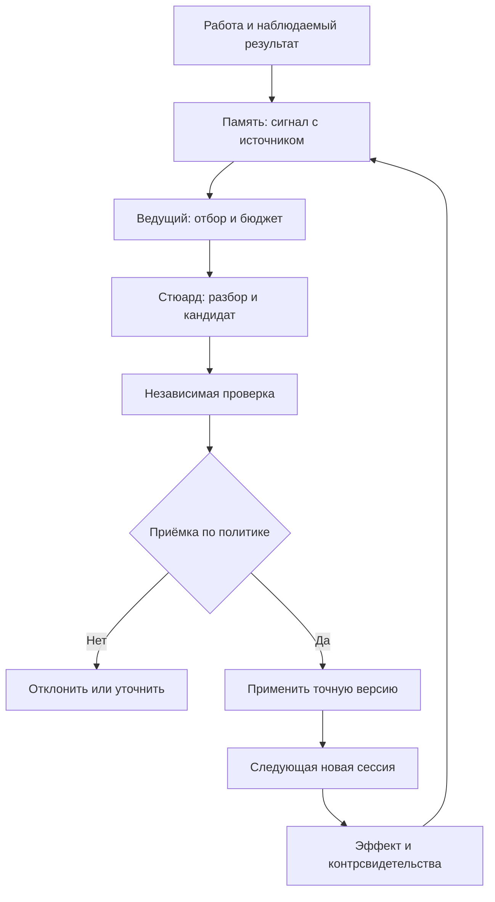

# 1. Архитектурное решение

Стюард — специалист ведущего с тем же жизненным циклом конечного поручения, а не постоянный руководитель и не сервис, ожидающий события. Метод обучения реализуется навыком `wolf-learning-cycle`; роль `wolf-steward` применяет его в границах TASK. Ведущий может выполнить короткую классификацию сам. Самостоятельный значительный разбор получает свежего Стюарда. Он не вызывает reviewer/tester: их напрямую назначает ведущий.



Это схема ответственности, не обещание уже существующего event runtime.

# 2. Компоненты и владельцы

| Компонент | Ответственность | Что ему запрещено |
| --- | --- | --- |
| mr-wolf | цель, план, бюджеты, назначение, принятие и решение о применении | передавать финальную приёмку автору кандидата |
| wolf-steward | классификация выбранного опыта, контрпримеры, proposal/diff, план испытания | спавнить, публиковать, менять oracle/права/общую цель, принимать своё изменение |
| wolf-researcher | при необходимости проверить отдельную неизвестную по внешнему методу | объявлять внешний метод рабочим для Wolf без испытания |
| wolf-developer | реализовать разрешённую правку навыка или механизм | смешивать обучение с продуктовой задачей и менять AC |
| wolf-tester | испытать baseline/candidate по замороженному протоколу | подогнать критерии под успешный текст |
| wolf-reviewer | проверить смысл, область, потери гарантий и доказательства | заменять реальный запуск текстовым APPROVED |
| wolf-release-engineer | доставить принятый общий набор по обычному релизному пути | переносить локальную удачу в глобальный пакет без решения |
| приложение Wolf | валидация конвертов, дедупликация, preflight, журнал операции, hashes, recovery | считать строку actor криптографическим подтверждением прав |

Новый базовый состав: 10 агентов. Существующие роли сохраняются. Встроенные старые aliases в этом выпуске можно оставить для внешней совместимости, но внутренние маршруты должны ссылаться на канонический skill. Удаление aliases — отдельная миграция, не обязательная зависимость возврата Стюарда.

# 3. Три контура знаний

## Отличие от Стюарда 2.33.0

Историческая рамка `templates/base/agents/steward.md` тега v2.33.0 действительно содержит две разные функции: мутацию playbooks по W1–W4 и агрегацию зрелых lessons. Библиотекарь/архивариус там обозначены как направления по мере реализации, а не готовые способности. Рамка запрещает самому анализировать документы/код и опирается на plugin-inject/faces и три уровня. Простое возвращение этого файла восстановит снятые зависимости.

| Старая функция/граница | Предлагаемый новый контракт |
| --- | --- |
| mutation playbook через face new | кандидат изменения проектного навыка через проверяемый trial/apply |
| plugin-inject и fallback playbook | обычная доставка роли/навыка на проверенном host-пути |
| «ты не аналитик: не анализируй документы и код сам» | адресный анализ evidence и целевого навыка разрешён; широкий product research — отдельное поручение |
| maturity ≥3 / ≥7 дней | сигнал полезности консолидации, не разрешение обобщать и не барьер срочного исправления нормы |
| заранее разрешённая агрегация без повторного вопроса | сохранить действующее проектное разрешение после усиления технического preflight; не превращать его в запрос на каждый кластер |
| гарантии безопасного apply в промпте | проверка типов, scope и recovery в общем use-case, для CLI и MCP |

Разрешения, уже явно данные владельцем конкретного проекта, не отменяются новым default. `suggest` — исходный режим нового проекта; прежняя разрешённая агрегация продолжает действовать в своём узком контуре, а не выдаёт автоматически право править навыки и политики.

1. **Проектные факты.** Как устроена среда, рабочая команда, локальное ограничение. Хранятся в существующей памяти с источниками и границами. Их доставка — короткая адресная подсказка, не новый универсальный SKILL.md.
2. **Процедуры.** Повторяемое действие/приём. Стюард предлагает правку конкретного проектного навыка или создание нового при доказанной повторяемости. Изменение имеет Git-версию, тест и откат.
3. **Общие нормы.** Права, приёмка, независимость, security, базовый маршрутизатор. Только отдельное решение владельца и обычный выпуск шаблонов; единичный проектный опыт их автоматически не переписывает.

Внешняя статья сначала относится к источникам. Только проверенный локальный вывод может перейти в один из трёх контуров. Успех/неуспех внешнего агента не является успехом/неуспехом Вольфа.

# 4. Что переиспользовать из кода

| Есть в 3.1.2 | Использовать | Чего это ещё не даёт |
| --- | --- | --- |
| complaint + rule/evidence/proposal | сигнал нарушения нормы | маршрутизацию к действующему Стюарду и проверку результата |
| note facet=proposal, `saveProposal`, `deliverProposal` | структурированное предложение с applicability_bounds | delivered_at означает доставку, не обработку/принятие |
| lessons + relation logs + aggregate plumbing | опыт и происхождение агрегата | безопасное автономное применение без полного preflight |
| `writing-skills` | метод baseline/candidate, false trigger, роли, rollback | реальные выполненные прогоны и принятие |
| Git/sync/keep/protect/backups | версия и сохранность локальных изменений | автоматическое слияние новой базы с локальным навыком |
| council records | источник совета по спорному решению | право активировать изменение |
| face history и операции | историческая совместимость | право менять современный skill через старый face API |

# 5. Предлагаемый минимальный контракт данных

Использовать существующие типы памяти: complaint, lesson, note/context/history, note/proposal. Не добавлять поля phase/trial_id в произвольные заметки через `--set`. Новый валидируемый конверт хранить в **body note/proposal** с tag `wolf:learning-change:v1`; общие поля существующего proposal заполнять штатно. Индекс конвертов — производный.

Ниже — **проект новой схемы**, не поддерживаемый сегодня формат:

```json
{
  "schema_version": 1,
  "change_id": "lc-example",
  "dedup_key": "sha256(project+target+problem+source-revisions)",
  "phase": "proposed",
  "kind": "skill_delta",
  "scope": {"project_id": "...", "target_paths": ["..."], "applicability": ["..."]},
  "sources": [{"ref": "memory-id-or-source", "revision": "...", "observed_outcome": "..."}],
  "baseline": {"files": [{"path": "...", "sha256": "..."}], "model": "...", "harness": "..."},
  "candidate": {"diff_ref": "...", "sha256": "...", "rationale": "...", "negative_cases": ["..."]},
  "trial": {"suite_ref": "...", "oracle_sha256": "...", "budget": {"tool_calls": 0}, "result_ref": null},
  "acceptance": null,
  "activation": null,
  "rollback": {"previous_ref": "...", "expected_active_sha256": "..."}
}
```

Допустимые phase внутри конверта: proposed → trialled → approved → active; declined, needs_context, retired, rolled_back — отдельные результаты переходов по схеме. Это **не новые MemoryStatus**. `approved` требует verdict/evidence и идентичности принятой версии; active требует фактической успешной активации. Не добавлять одновременно второй несогласованный статус в произвольный frontmatter.

На каждое изменение хранить точный diff, baseline/candidate content hash и evidence в постоянном проектном месте по его Git-политике. Для проектных навыков исходники остаются обычными файлами проекта. Реестр — указатель, не вторая копия всего навыка. Операционный журнал apply/recovery может храниться под `.wolf/learning/operations/`; это предлагаемый новый служебный формат, не существующая гарантия.

# 6. Полномочия и режимы

Предлагаемая новая настройка `learning.mode`:

- `off`: ничего не назначается и не подсказывается;
- `suggest` (default): очередь и предложения; активация требует отдельного действующего разрешения;
- `apply-approved`: после независимых проверок ведущий может принять разрешённое политикой локальное изменение, приложение применяет только точную принятую версию.

Стюард может читать назначенные evidence и формировать RESULT. По умолчанию не пишет память, не меняет runtime-файлы и не запускает shell. Если ему поручена подготовка diff, он пишет только в выделенную область кандидата; отдельное разрешение не расширяет доступ к активным skill-файлам. Для разработки patch при необходимости используется wolf-developer, напрямую назначенный ведущим.

Обычный низкорисковый локальный приём допускается по заранее утверждённой политике, без повторного вопроса на каждый файл. Изменение прав, критериев приёмки, человеческих гейтов, глобальных шаблонов, внешней публикации, удаления источников и экспериментального oracle — решение владельца. Заголовок жалобы и `created_by` не выдают полномочия.

Технические гарантии ограничены штатными путями приложения и фактическим host sandbox. Агент с произвольным shell/filesystem под тем же OS-пользователем может обойти файлы журнала; этот релиз не заявляет защиту от такого привилегированного противника. Нельзя выдавать текстовый запрет за OS-изоляцию.

# 7. Триггер и очередь

Детерминированный due рассчитывается из новых/изменившихся сигналов после курсора. Это не полное сканирование тела всех документов или opencode.db. Основные индексы: project, type, changed_at/cursor, target, disposition. Порог числа сигналов и лимит пакета конфигурируются и имеют тесты; semantic clustering не нужен для первого полезного результата.

Триггер: явный запрос пользователя либо завершение/передача самостоятельной цели при наличии новых релевантных сигналов и бюджета. Не каждый RESULT, не каждое сообщение, не каждый tool error. Таймер и plugin hooks не обязательны. Без инструментального события ведущий использует процессный checkpoint; это честно обозначается как метод, не автоматический background runtime.

Серьёзная доказанная жалоба может породить немедленный кандидат, не ожидая зрелости кластера. Продуктовый результат и исправление правила остаются разными поручениями. Контрсвидетельство к активной подсказке выводит её из доставки до разрешения конфликта; исходный факт не удаляется.

# 8. Применение и восстановление

1. Проверить mode, решение/мандат, непустую независимую проверку, accepted hashes, все пути и ожидаемые текущие hashes. Проверить, что затронутые skill-файлы не используются действующими поручениями; при неизвестной семантике hot reload отложить применение до остановки нужных сессий.
2. Сохранить baseline и намерение операции. Сделать preflight **всех** файлов до первой мутации. Разрешённые project paths задаются конфигурацией, path traversal и symlink escape запрещены на штатном пути.
3. Применить точный patch и журналировать каждую запись. Для multi-file ошибки — восстановление только совпадающих с записью операции файлов либо остановка с точным partial-state; не утверждать атомарность filesystem там, где её нет.
4. Проверить фактические hashes, сохранить active revision и provenance. По необходимости оформить существующий sync `keep` по явному решению владельца локального файла; не устанавливать protect всему набору.
5. В новом поручении/сессии доставить точную версию. Предыдущая уже выполняющаяся задача не меняет правила задним числом. Запись delivered_version в TASK/evidence не является техническим pin без проверенного способа загрузки; host-путь испытать отдельно.
6. При откате проверить, что текущие файлы совпадают с принятой активной версией. Если есть новые чужие правки — отказ, сохранение и отдельное разрешение конфликта. Повторный rollback даёт noop.

Старый глобальный пакет не перезаписывать автоматически. Локальный опыт → проектный skill; продвижение в `templates/base` → отдельная ветка, независимые прогоны минимум на двух разных профилях проекта и обычный релиз. Обновление vendor base поверх локального навыка не сливать молча.

# 9. Предлагаемая CLI/MCP поверхность

Возможные новые операции: `wolf learn queue`, `wolf learn candidate`, `wolf learn trial record`, `wolf learn apply`, `wolf learn rollback`. Точное имя зависит от **существующего** семейства `wolf learn`: реализация сначала проверяет registry/help и дополняет его без коллизий. Это не команды для 3.1.2. MCP должен вызывать те же use-cases и валидацию, не самостоятельную копию бизнес-логики.

Разделить read-only query, запись кандидата/evidence и применение. CLI выводит краткий человеческий результат и JSON по единому контракту. Replay сохранённого запроса не повторяет изменение; изменённый запрос с прежним request_key вызывает конфликт.

# 10. Измерение

Единица пользы — **принятый пользовательский результат**, не число lessons или исправленных skills. Сравнивать качество, rework, вмешательства, время и полные расходы. `learning` и `council` — атрибуты назначения вызова; по уровням остаются L0/L1. Стоимость Стюарда включена в общую сумму и одновременно видна отдельным срезом.

Формула при доступных тарифах: `Ctotal = Σ(call.cost)` по уникальным вызовам. В составе call.cost отдельно сохранять категории cache/input/output, если хост их даёт. `ΔC = Ccandidate − Cbaseline`; сравнивать также качество и failures. При подписочном плане без тарифа отчёт по usage не выдавать за реальные денежные расходы.

Для микрознания фиксировать selected, delivered, observed_use, observed_outcome. Счётчик delivered не доказывает причинной пользы. Для обобщения эффекта нужны парные серии, раздельные development и held-out задачи, одинаковые доступные инструменты, модель и порядок/сброс состояния. Не обучать кандидата на скрытых ответах оценщика.

# 11. ADR и открытые решения

ADR-01: сохранить два уровня и добавить специалиста вместо старой иерархии. ADR-02: память — факты/основания; навыки — исполняемые процедуры; не класть все выводы в постоянный промпт. ADR-03: proposal/evidence отделены от применения. ADR-04: сначала локальный опыт, потом переносимость. ADR-05: ограниченный детерминированный trigger, без нового обязательного plugin runtime. ADR-06: безопасность и качество — жёсткие ограничения, стоимость — оптимизируемая величина после них.

Перед реализацией решить PD-01–PD-06 из pre-requirements, имя CLI-группы с учётом существующего learn, профиль разрешённых локальных правок и бюджет живой кампании. Утверждение статьи не заменяет эти решения.
